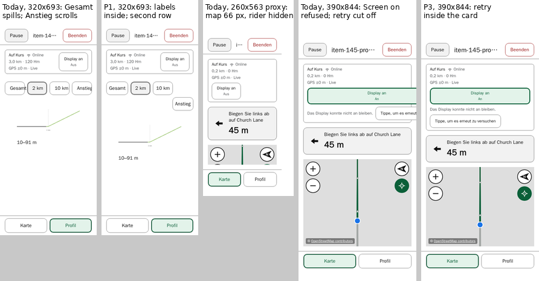

# Item 145 — Device zoom findings: evidence, diagnosis and a proposed next slice

**Current direction (13 October 2026).** The rider revised item 145's direction: Regular and Larger text modes, supported at default browser text and 100% page zoom across a documented range of phone sizes ([proposal](text-modes-proposal.md)). **P1 and P3 below are paused.** P1's second selector row is not to be built for an enlarged-text check; a padding-only selector correction is proposed in its place. The findings here stay recorded unchanged. The recommended next slice, provisional target and decisions below are the 12 October record, superseded as the current proposal. **On 14 October 2026 the padding-only selector correction alone shipped in `0.4.70` and was accepted on the installed iPhone** under ordinary and enlarged Display Zoom, in German ([record](../../project/backlog.md#item-145-selector-slice)). D3's 150% Page Zoom case was not rechecked.

**Status (12 October 2026): documentation only. The proposals await the rider's review, and nothing is implemented.** E2, E2+N, hiding the remaining ascent, extra Screen on taps and compound-failure exceptions all remain unapproved, and none is proposed here.

- **The device evidence** is the rider's report of 12 October 2026 on the installed iPhone 13, recorded in [`current-status.md`](../../project/current-status.md#installed-iphone-observations-of-text-enlargement-mechanisms-item-145-reported-12-october-2026).
- **The baseline** is `4164bcc`, the build the phone was running. Its application files are identical to `cdc0529` and to `677a03e`, the broad phone-accepted build; the diagnostics used the same `cdc0529` build as item 145's earlier reports.
- **What did not change:** no application, test, CI or version.

The companion reports are [the first report](README.md), [Riding information priorities](information-priorities.md) and [the text-enlargement support report](text-enlargement-support.md).

## Summary

1. **On this iPhone, two text-size controls changed nothing visible, while Display Zoom and Safari's Page Zoom setting did change the installed app.** Larger Text and Control Centre's Text Size produced no visible enlargement. Pinch zoom works and can be reversed; it does not keep the navigation inside the magnified area.
2. **The Profile range selector overflows because its fixed four-column grid lets a track shrink below its label.** The Profile pane is the element that scrolls horizontally. In the CI image's fonts, German's `Gesamt` leaves its button from 320 px wide, and `Anstieg` then needs horizontal scrolling. The 320×693 sensitivity case reproduces both device symptoms; the hypothetical 375×812 Display Zoom proxy reproduces neither.
3. **At the 150% page-zoom proxy, route riding loses its map mainly to height.** The viewport is 281 px shorter, and narrowness adds 84 px more: the Screen on toggle drops below the status text, and the turn instruction takes a second line. That leaves 66 px of map with 31/23 px insets, or 39 px with 47/34. The rider is held 140 px down a container with a 160 px floor, so it is hidden below about 145 px of visible map.
4. **A further, automated-only defect: a refused Screen on request pushes its retry past the screen's edge at ordinary German text.** The control takes the width of its one-line failure sentence. At 390×844 the retry is 58% on screen; at 320×693, 28%.
5. **Three disposable prototypes were measured:**
   - **P1** fixes the selector with a wrapping row. It leaves 375–390 px unchanged and adds a second row only where a label cannot fit.
   - **P2**, the status card's toggle kept beside its text, is **rejected**. It gains at most 37 px at the proxy, which is not enough, and it crushes the refused state's text column to 1 px at ordinary text.
   - **P3** keeps the refused Screen on control inside the card. It costs 26 px at ordinary text, and more at 200%, where it trades the retry for the switcher in German.
6. **No small change was found that restores a usable route-riding map at the page-zoom proxy.**

**Proposed next implementation slice:** P1. P3 is a separate decision for the rider, with its trade-off stated. The map at 150% page zoom stays a measured, reported finding until the rider decides whether a larger design change is wanted.



## Contents

- [The device evidence](#the-device-evidence)
- [Method and labels](#method-and-labels)
- [D3 — the Profile range selector](#d3--the-profile-range-selector)
- [D4 — the route-riding map at the page-zoom proxy](#d4--the-route-riding-map-at-the-page-zoom-proxy)
- [Recovery states at constrained widths](#recovery-states-at-constrained-widths)
- [P1 — the selector wraps instead of overflowing](#p1--the-selector-wraps-instead-of-overflowing)
- [P2 — the Screen on toggle beside the text: rejected](#p2--the-screen-on-toggle-beside-the-text-rejected)
- [P3 — the refused Screen on control kept inside the card](#p3--the-refused-screen-on-control-kept-inside-the-card)
- [The map at 150% page zoom: no small change](#the-map-at-150-page-zoom-no-small-change)
- [A provisional support target](#a-provisional-support-target)
- [The navigation label](#the-navigation-label)
- [Recommended next implementation slice](#recommended-next-implementation-slice)
- [Decisions for the rider](#decisions-for-the-rider)
- [Limitations](#limitations)
- [Reproducing](#reproducing)

## The device evidence

The rider's report, as recorded in [`current-status.md`](../../project/current-status.md#installed-iphone-observations-of-text-enlargement-mechanisms-item-145-reported-12-october-2026): the installed Home Screen ACN on an iPhone 13, iOS 26.6.1, in German, `0.4.69` / `4164bcc`.

| Check                         | Setting                                                           | Observed                                                                                                                                                                                                                                                                       | Closed and reopened                |
| ----------------------------- | ----------------------------------------------------------------- | ------------------------------------------------------------------------------------------------------------------------------------------------------------------------------------------------------------------------------------------------------------------------------ | ---------------------------------- |
| 1. Larger Text                | Slider fully right                                                | No visible change; the Routes screenshots support this                                                                                                                                                                                                                         | Yes                                |
| 2. Control Centre's Text Size | Scopes "Nur Web" and "Alle Apps"; "Nur Web" chosen; 3/11 vs 11/11 | No visible enlargement on Routes, Planning or Status                                                                                                                                                                                                                           | Yes                                |
| 3. Display Zoom               | Use Zoomed                                                        | Visible enlargement and reflow. Profile: `Gesamt` beyond its button; `Anstieg` whole after horizontal scrolling; both tappable. Switcher visible, maps kept the rider and four controls, in the supplied views. `Einstellungen` wraps                                          | Not reported                       |
| 4. Safari's Page Zoom setting | 150%; Display Zoom restored                                       | Reaches the installed app. The selector overflow recurs; `Display an` below the status text. At a 0 m turn instruction, a narrow map strip: upper controls partly clipped, rider and lower controls not visible; no failed End; switcher visible. Free roam kept much more map | Launched from the Home Screen only |
| 5. Pinch zoom                 | On a screen, not a map                                            | The page magnifies; edges and navigation leave the visible area; it pans; buttons respond; pinching back restores it                                                                                                                                                           | Yes: reopening resets it           |

**Scope.** These results hold for this device, iOS version, build, language and these settings only. They do not convert the text-size slider positions into percentages, and they do not assume "Nur Web" applies to ACN alone.

**What they are.** Mechanism observations and defect reports. They accept nothing: not E2, not a support policy, and not item 145's closure.

**What the phone did not measure:**

- which element scrolled;
- the CSS viewport that Display Zoom or Page Zoom produces;
- the safe-area insets under page zoom.

**The switcher.** "The switcher stayed visible" describes the supplied riding captures of checks 3 and 4. Under pinch magnification, the edges and navigation left the visible area.

## Method and labels

**Setup:**

- disposable probes outside the repository;
- the CI image by digest, at two workers, in desktop Chromium and desktop WebKit;
- English and German.

Every page reported its own layout viewport, visual viewport, scale, device-pixel ratio, root font size and safe-area insets. Inset overrides use the `--safe-area-inset-*` custom properties, as the repository's tests do.

| Label                                | Layout viewport (CSS px) | Insets, top / bottom        | Root font    | Status                                                                                   |
| ------------------------------------ | ------------------------ | --------------------------- | ------------ | ---------------------------------------------------------------------------------------- |
| Reference                            | 390×844                  | 47 / 34 (none in D3)        | 16 px        | The iPhone 13's portrait viewport and insets                                             |
| Display Zoom proxy, **hypothetical** | 375×812                  | 47 / 34                     | 16 px        | **Assumed and unvalidated**; the device observations do not establish it                 |
| Narrower sensitivity cases           | 340×736, 320×693         | 47 / 34                     | 16 px        | Sensitivity only, not a claim about any device mode                                      |
| Page Zoom 150% proxy                 | 260×563 (390×844 ÷ 1.5)  | 31 / 23 (÷ 1.5) and 47 / 34 | 16 px        | **Assumed**; how iOS reports insets under page zoom is unverified, so both were measured |
| Enlarged root text                   | 390×844                  | 47 / 34 (none in D3)        | 32 px (200%) | The tests' existing condition                                                            |

**Every case used a visual viewport equal to its layout viewport, at scale 1 and a device-pixel ratio of 1.** None is native Display Zoom, native page zoom or pinch zoom. The CI image's fonts are not iOS fonts: item 113's German pass showed they do not predict iOS widths. So every pixel figure below is a container measurement, and Chromium and WebKit agreed in every compared case.

**The Planning-route fixture** is item 145's trusted route at an imminent turn, 45 m away. Its German instruction takes one line at 375–390 px and two lines below that. The device's 0 m case was not reproduced exactly.

## D3 — the Profile range selector

**The mechanism**, from source (`src/index.css`, item 80):

- In the active Profile pane, the group is `display: grid` with `grid-template-columns: repeat(4, minmax(0, 1fr))`.
- `minmax(0, …)` lets each track shrink below its button's content. The global button rule's 16 px inline padding and 44 px minimum width do not stop a one-word label from being wider than its track, so the label spills out of its button.
- The pane, `.ride-profile-pane--immersive`, is `overflow-y: auto`, which makes its `overflow-x` compute to `auto`. When the fourth button's spill passes the pane's edge, **the pane scrolls horizontally.** The group itself does not scroll, and neither does the document.

**Measured** on a 3 km route with one recognised climb, so that `Anstieg` / `Climb` renders, with no insets. The figures are each label's intrusion into its button's 16 px inline padding; "beyond" means past the button's border.

| Viewport      | German                                           | English                                    | Pane scrolls horizontally (scroll / client width) |
| ------------- | ------------------------------------------------ | ------------------------------------------ | ------------------------------------------------- |
| 390×844       | `Gesamt` 4 px into its padding                   | Inside                                     | No                                                |
| 375×812       | `Gesamt` 8 px, `Anstieg` 5 px into their padding | Inside                                     | No                                                |
| 340×736       | `Gesamt` reaches its border; `Anstieg` 13 px in  | `10 km` 7 px in                            | No                                                |
| 320×693       | `Gesamt` 5 px beyond, `Anstieg` 2 px beyond      | `10 km` 12 px in                           | German: 290 / 288                                 |
| 260×563       | `Gesamt` 20 px beyond, `Anstieg` 17 px beyond    | `10 km` 11 px beyond, `Climb` 5 px beyond  | German 245 / 228; English 233 / 228               |
| 390×844, 200% | `Gesamt` 42 px beyond, `Anstieg` 36 px beyond    | `10 km` 24 px beyond, `Climb` 12 px beyond | German 394 / 358; English 370 / 358               |

**Reachability.** Every button was tappable at its centre. After the pane was scrolled to its end, the fourth button was wholly visible and tappable.

**Without a climb**, the labels spill just the same, but the pane does not scroll: the empty fourth track absorbs the overflow.

**Against the device:**

- The 320×693 and 260×563 cases reproduce both device symptoms: `Gesamt` beyond its button, and `Anstieg` reached by horizontal scrolling. The 340×736 case and the hypothetical 375×812 case reproduce neither.
- That is consistent with Display Zoom producing a layout viewport near 320 CSS px, or with iOS fonts being wider than the container's, or with both. It establishes neither, and it neither supports nor refutes the 375×812 assumption.
- Under page zoom, the 260×563 proxy reproduces both symptoms in both languages.

## D4 — the route-riding map at the page-zoom proxy

**Measured before any End failure**, on the Planning route at its imminent turn, on an imported GPX route without turn cues, and in free roam.

**German, Planning route at its imminent turn.** English differs only where its instruction stays on one line: 296 px of map at 340×736 and 253 px at 320×693.

| Row                             | 390×844, 47 / 34 | 375×812, 47 / 34 | 340×736, 47 / 34 | 320×693, 47 / 34 |                 **260×563, 31 / 23** | **260×563, 47 / 34** |
| ------------------------------- | ---------------: | ---------------: | ---------------: | ---------------: | -----------------------------------: | -------------------: |
| Header, with its inset          |              108 |              108 |              108 |              108 |                                   92 |                  108 |
| Status card                     |               80 |               80 |               80 |               80 | **143**: `Display an` below the text |              **143** |
| Manoeuvre card                  |     89, one line |               89 |   110, two lines |              110 |                                  110 |                  110 |
| **Visible map**                 |          **404** |          **372** |          **275** |          **232** |                               **66** |               **39** |
| Switcher block, with its inset  |              115 |              115 |              115 |              115 |                                  104 |                  115 |
| The rider                       |          Visible |          Visible |          Visible |          Visible |                           **Hidden** |           **Hidden** |
| Map controls wholly visible     |                4 |                4 |                4 |                4 |                        2; two partly |        0; two partly |
| Attribution visible             |              All |              All |              All |              All |                                 None |                 None |
| Switcher on screen and tappable |              Yes |              Yes |              Yes |              Yes |                                  Yes |                  Yes |

Rows are separated by three 16 px gaps, and each column sums to its viewport's height.

**At the 260×563 proxy, the other variants:**

- **An imported GPX route without turn cues:**
  - with 31/23 px insets, 132 px of map and four whole controls, but the rider hidden and 40% of the attribution;
  - with 47/34, 105 px, the rider hidden and two controls partly cut.
- **Free roam:** 318 px of map, or 302 with 47/34. The rider, four controls and the attribution are whole. Its status card, also wrapped, is 121 px.

**Why the map is lost.** From 390×844 to 260×563 with 31/23 px insets:

- **Height is the dominant cause.** The viewport is 281 px shorter, offset only by 27 px from the smaller insets.
- **Narrowness adds 84 px:**
  - **63 px from the status card:** its Screen on toggle drops below the text, as on the phone, because the card's main row is `flex-wrap: wrap` and the text's unwrapped width plus the toggle no longer fit;
  - **21 px from the manoeuvre card:** its instruction takes a second line.
- **The map container keeps a 160 px floor inside a region that clips it.** The follow camera holds the rider at H/2 + 60, which is 140 px down that container. **So the rider is hidden whenever less than about 145 px of map is visible.** The four controls need about 120 px to be whole: two stacked pairs, plus their insets.

Even with no growth from narrowness, the map would be about 150 px: at the edge for the rider.

**The insets.** Undivided 47/34 px insets cost 27 px more map than 31/23. The phone's description, with the upper controls partly clipped, resembles the 47/34 case more closely: with 31/23 they are whole. But container fonts and the unknown iOS viewport make that resemblance no verification.

**A location error at the proxy, before any End:**

- on the Planning route at its imminent turn, it leaves **no map, and the switcher off screen**, in both languages;
- free roam keeps 226 px of map.

## Recovery states at constrained widths

**Location error.** `Try again` / `Erneut versuchen` is whole and tappable in every case measured. The map is what suffers.

| Planning route, imminent turn, with 47/34 px insets unless stated | 390×844   | 375×812   | 340×736   | 320×693                            | 260×563, 31 / 23       | 390×844, 200%          |
| ----------------------------------------------------------------- | --------- | --------- | --------- | ---------------------------------- | ---------------------- | ---------------------- |
| Map, German / English                                             | 288 / 335 | 256 / 277 | 180 / 180 | 53 / 137, the rider hidden in both | 0, switcher off screen | 0, switcher off screen |

The earlier reports, without insets, found this 200% loss in German only. With the iPhone's 47/34 px insets, English loses the switcher in that state too.

**A refused Screen on request: a further defect, automated only.**

- **The mechanism.** `.ride-wake-lock-control` is `flex: 0 0 auto`, so it takes the width of its content. When a request is refused, that content includes the one-line failure row: the sentence and the `Tap to try again` button. In the refused state, the card's main row wraps the control below the text, but the control keeps that width. It does not shrink to the card.
- **The result, in the CI image:**
  - **390×844, German:** the control is 460 px wide in a 358 px card. The retry is 58% on screen, cut at the screen's edge, still tappable at its centre.
  - **390×844, English:** on screen, but 7 px past the card's edge.
  - **320×693:** German 28% on screen and not tappable at its centre; English 51%.
  - **260×563:** 2–3% on screen.
  - **200%:** wholly off screen, in both languages, as the earlier reports found for German.
- **Its scope:** both engines, the Planning route and free roam alike.
- **Not established:** whether iOS fonts give the same widths, and how often a request is refused on a phone. **No phone result exists.**

This extends a carried-forward item 145 finding, the clipped Screen on retry at German 200%, down to ordinary text. Contract A requires warnings and recovery to be visible.

## P1 — the selector wraps instead of overflowing

**The change**, inside the active Profile pane only:

```css
.ride-profile-pane--immersive .elevation-window-group {
  padding-inline: 0;
  display: flex;
  flex-wrap: wrap;
}

.ride-profile-pane--immersive .elevation-window-group > .elevation-window-button {
  flex: 0 1 calc((100% - 3 * var(--space-8)) / 4);
  min-width: min-content;
  padding-inline: var(--space-8);
}

.ride-profile-pane--immersive
  .elevation-window-group
  > .elevation-window-button:nth-child(4) {
  margin-inline-start: auto;
}
```

**How it works:**

- Each button keeps a quarter-width basis and never grows, so whenever the labels fit, the geometry is exactly today's.
- `min-width: min-content` stops a label from leaving its button: a button that cannot hold its longest word moves to a second row instead.
- The 8 px inline padding is half the global 16 px. It is what lets German fit its unchanged quarter at 375–390 px.
- When `Climb` / `Anstieg` wraps alone onto the second row, `margin-inline-start: auto` keeps its right edge on the pane's edge, as item 80's 200% test requires. With four buttons on one row there is no free space, so it changes nothing there.
- The pre-ride selector already wraps; this brings the active one to the same principle.

**How it got here.** Two earlier versions were measured and set aside:

- with the global 16 px padding, German wrapped already at 390×844, which changes the ordinary layout;
- without the margin rule, a wrapped `Climb` sat at the left, contrary to item 80's flush-right test at 200%.

**Measured** in both engines, in both languages, on routes with and without a climb, at every D3 size:

| Case                                    | Today                                        | P1                                                                                                                                                          |
| --------------------------------------- | -------------------------------------------- | ----------------------------------------------------------------------------------------------------------------------------------------------------------- |
| 390×844 and 375×812, both languages     | One row; German spills into its padding      | **Identical button boxes**; each label centred in its own button, moving by at most 4.3 px                                                                  |
| 340×736 and 320×693, German, with Climb | Spills; at 320, 2 px of horizontal scrolling | `Anstieg` on a second row, flush right: **+52 px**. The default view still fits: 291 px in a 482 or 439 px pane                                             |
| 340×736 and 320×693, English            | Fits, or spills into its padding             | Unchanged geometry                                                                                                                                          |
| 260×563, both languages, with Climb     | Spills; 5–17 px of horizontal scrolling      | Second row, **+52 px**. The default view now needs **45 px of vertical scrolling** (291 in 246 px): the chart's last 2 px are below the fold until scrolled |
| 390×844 at 200%, with Climb             | Spills; 12–36 px of horizontal scrolling     | Second row, **+70 px** (62 → 132). The default view fits: 388 in 408 px                                                                                     |
| Climb view, wherever the row wraps      | Already scrolls vertically (646–1408 px)     | **+52 px**, or +70 at 200%, before the climb details                                                                                                        |
| Without a climb                         | Labels spill; no scrolling                   | One row at every size measured. In German, `Gesamt` widens and its neighbours move by up to 49 px at 200%                                                   |

**What P1 removes and what it costs.** It removes every label overflow and all horizontal scrolling. Its cost is vertical: 52–70 px wherever a label cannot fit its quarter. **At 260×563 that turns horizontal scrolling into 45 px of vertical scrolling** in the default view. The chart and the climb details move down by the same amount.

**What stays:**

- **Item 80's geometry:** `Full`, `2 km` and `10 km` are identical with and without `Climb`, in every case.
- **Touch targets:** every button is at least 44 px tall, or 62 px at 200%, and at least 51 px wide. Each is tappable at its centre.
- **The selected ring:** the inset 2 px ring stays on the selected `2 km`.
- **The focus outline:** 2 px at a −2 px offset, inside its button and inside the pane, measured on `10 km` and `Climb` after a real `Tab`. That is Chromium only: desktop WebKit's `Tab` does not reach buttons by default.

**The existing tests.** Every geometry the existing selector assertions check was measured and holds:

- item 80's equal widths at 390 px;
- equal widths in the retained landscape check: 197 px each at 844×390, in both languages, with and without a climb;
- the flush left and right edges, at ordinary text and at 200%.

The tests themselves were not run against the prototype.

## P2 — the Screen on toggle beside the text: rejected

**The change:** `.ride-status-card-main { flex-wrap: nowrap }`, so the toggle stays beside the text, and the text wraps instead.

| Case                                         | Today                                             | P2                                                                                                 |
| -------------------------------------------- | ------------------------------------------------- | -------------------------------------------------------------------------------------------------- |
| Plain states at 320–390 px                   | Card 73–80 px                                     | Unchanged                                                                                          |
| Location error, 320×693, German              | Card 217 px, the toggle below the text; map 53 px | Card 172 px; map 98 px; the rider still hidden                                                     |
| **Refused Screen on, 390×844**               | Card 195 px; retry partly off screen in German    | **The text column collapses to 1 px**, 10–11 lines tall; card 214 / 232 px; retry still off screen |
| 260×563 proxy, Planning route, imminent turn | Card 143 px; map 66 px                            | Card 106 / 124 px (German / English); map 103 / 85 px; rider still hidden; two controls            |
| 260×563 proxy, location error                | Map 0; switcher off screen                        | The same                                                                                           |
| 390×844 at 200%, Planning route              | Card 230 px; map 117 px; four controls            | **Card 250 px; map 97 px; two controls.** The toggle stretches to the narrowed text's height       |
| Free roam, 260×563                           | Card 121 px                                       | 84 px: 37 px more map                                                                              |

**Rejected.** It helps where the toggle would otherwise drop below the text, such as German's location error at 320×693, but:

- it changes the ordinary-text refused state for the worse;
- it makes 200% worse;
- at the proxy it gains 19–37 px, which restores neither the rider nor the lower controls.

Any variant that let both columns shrink would still trade the toggle's width against a narrower text column at the sizes that need help, so none was pursued.

## P3 — the refused Screen on control kept inside the card

**The change:** `max-width: 100%` on `.ride-wake-lock-control`. It keeps the control no wider than the card, so the failure row wraps inside it: the sentence, then the retry beneath it.

| Case                             | Today                                                  | P3                                                                                                                   |
| -------------------------------- | ------------------------------------------------------ | -------------------------------------------------------------------------------------------------------------------- |
| Every state without a refusal    | —                                                      | **Unchanged**                                                                                                        |
| Refused, 390×844, both languages | German retry 58% on screen; English 7 px past the card | **Whole, inside the card**; card +26 px. Planning route map 289 → 263 px, with the rider and four controls           |
| Refused, 320×693                 | German 28% on screen; English 51%                      | Whole; card +26 px. Planning route map 117 → 91 (German): the rider was already hidden, and now two controls are cut |
| Refused, 260×563 proxy           | 2–3% on screen                                         | Whole; card +44–54 px. Map 14 → 0; **the switcher leaves the screen in German**                                      |
| Refused, 390×844 at 200%         | Off screen                                             | Whole; card +80 px (English) or +116 px (German). Map 55 → 0; **the switcher leaves the screen in German**           |
| Free roam, refused               | —                                                      | Map 531 → 505 px; at 200%, 434 → 318 (German) or 354 (English)                                                       |

**What it settles, and what it does not:**

- **At ordinary text, P3 repairs a contract A defect** for 26 px of map, keeping the rider and controls.
- **At 200% and at the proxy, it trades one loss for another.** Today the retry is unreachable and the switcher is on screen; with P3, in German, the retry is reachable and the switcher is not.
- Neither meets level B for that state. The earlier E2 proposal would show the retry differently, and it remains unapproved.

## The map at 150% page zoom: no small change

**No change measured here restores a usable route-riding map at the 260×563 proxy:**

- P2's 19–37 px is too little, and it fails elsewhere.
- Removing all 84 px of growth from narrowness would still leave the rider at the edge, and that is not achievable without hiding content.
- Hiding overflow would only conceal what is lost.

**Larger options, not prototyped,** for the rider's decision:

- **The map's floor and follow anchor taken from the visible region,** not the container's 160 px floor. This is a camera change, and compatibility-sensitive. It would keep the rider in a short map, but not the four controls below about 120 px.
- **A height-gated constrained presentation,** engaged only when the riding column is short. It overlaps E2's territory and decisions, and E2 is not approved.
- **Measuring and reporting the map at 150% page zoom,** with no change for now. **This is reporting, not an agreed relaxation:** whether a narrow map at 150% page zoom is acceptable is the rider's decision.

## A provisional support target

**For discussion only; nothing here is approved,** and the support report's levels A–C still await review.

| Mechanism on the iPhone 13                          | Device evidence, 12 October 2026                                                                                            | Proposed provisional target                                                                                                     | Not promised                                                                                                                                                                                             |
| --------------------------------------------------- | --------------------------------------------------------------------------------------------------------------------------- | ------------------------------------------------------------------------------------------------------------------------------- | -------------------------------------------------------------------------------------------------------------------------------------------------------------------------------------------------------- |
| Larger Text; Control Centre's Text Size ("Nur Web") | No visible enlargement                                                                                                      | None from this evidence. Dynamic Type stays a separate product decision                                                         | That no other setting, scope or iOS version reaches ACN                                                                                                                                                  |
| Display Zoom                                        | Visible enlargement and reflow; selector overflow; the supplied riding views kept the rider, four controls and the switcher | Labels inside their controls, nothing reached only by horizontal scrolling (P1), and recovery actions visible (P3, if approved) | **The full riding contract.** The device checked a few states only. At 320×693 a location error or a refused request already hides the rider on a Planning route, and Display Zoom's viewport is unknown |
| Safari's Page Zoom setting at 150%                  | Reaches the installed app; selector overflow; a narrow route-riding map                                                     | Labels and controls as for Display Zoom; the switcher and the map **measured and reported**                                     | A usable route-riding map, and the switcher in a location error: the proxy loses both                                                                                                                    |
| Pinch zoom                                          | Works; reversible; resets on reopening                                                                                      | Never blocked                                                                                                                   | Navigation inside the magnified area                                                                                                                                                                     |
| The tests' 200% root text                           | —                                                                                                                           | Unchanged from the support report's proposed level B                                                                            | —                                                                                                                                                                                                        |

## The navigation label

**On the phone,** under Display Zoom, `Einstellungen` wrapped, its final "n" on a line of its own.

**In the CI image** the unbroken label is 65.5 px wide at the navigation's 11.2 px type. Its tab's spare width:

| Width | 390     | 375     | 340     | 320    | 300    | 260     |
| ----- | ------- | ------- | ------- | ------ | ------ | ------- |
| Spare | 25.0 px | 21.3 px | 12.5 px | 7.5 px | 2.5 px | −7.5 px |
| Lines | 1       | 1       | 1       | 1      | 1      | **2**   |

In the container's fonts the label first breaks somewhere between 300 and 260 px. The phone's break therefore means a narrower viewport than that, iOS fonts wider than the container's, or both; 12% wider type would break it at 320 px. The English labels were not measured: the probe's own language check failed on `en-GB`.

**Disposition:** a related observation, not part of item 145's riding work.

- Items 113 and 121 are **not reopened**. Their German containment, `overflow-wrap: anywhere` with zero inline padding, is designed to break a word that cannot fit inside its tab rather than let it overflow. A one-letter break is what it does.
- **Proposed destination:** an input to [item 103](../../project/backlog.md#item-103)'s visual audit, which owns the navigation's presentation, alongside items 127, 135, 136 and 137. If the rider prefers, it can become its own item instead.

## Recommended next implementation slice

**The slice: P1.** The active Profile range selector wraps instead of overflowing.

- Local to the active Profile pane's CSS, and ordinary text unchanged at 375–390 px.
- Item 80's geometry and every existing selector test hold.

**Its tests**, proposed:

- **One focused browser test**, in Chromium and WebKit in the CI image. It needs a real browser because it is about real text layout. At 390×844 in German: four equal quarter-width buttons, with each label inside its own button, which shows ordinary text unchanged. At 320×693 in German on a climb route: the Profile pane does not scroll horizontally; every label is inside its button; every button is at least 44 px; `Anstieg` sits on a second row, flush right. Plus item 80's identical geometry with and without a climb.
- **The overlap:** item 80's existing tests cover 390 px and 200% in English, so the new test adds German and a narrow width only.
- **A negative control:** restoring the grid must fail the new test at 320×693 in German.
- **No unit test,** since the change is CSS only.

**Its phone checks:**

- **German, on a climb route:** in Profile under Display Zoom, and again at 150% Page Zoom, every label sits inside its button, nothing needs horizontal scrolling, and every button responds.
- **At ordinary text:** the selector is unchanged.

**P3, if the rider includes it.** One browser test of a stubbed refusal at 390×844 in German: the toggle and retry inside the card and on screen. Plus a recorded measurement of the 200% trade-off. A refusal cannot be produced reliably on the phone, so its evidence would be automated only.

**Not in the slice:**

- any change to the map at 150% page zoom;
- E2 or any disclosure;
- the navigation label;
- items 142, 103 and 120.

## Decisions for the rider

1. **P1:** approve it as item 145's next implementation slice, or amend it.
2. **P3:**
   - include it in the same slice, as a separate slice, or defer it to the enlarged-text presentation decision;
   - at ordinary text it is a gain, while at 200% and at the proxy it trades the retry for the switcher in German.
3. **The map at 150% page zoom:**
   - measure and report it, with no change now;
   - or commission a design investigation of the larger options: the map's anchor and floor, or a height-gated presentation.
4. **The provisional support targets** above: adopt, amend, or leave until the support report's levels are decided.
5. **The navigation label:** an input to item 103's audit, as proposed, or its own item.

## Limitations

- **No native Display Zoom, page zoom or pinch zoom was reproduced.** Every figure is a viewport proxy in desktop Chromium and WebKit with container fonts. The 375×812 Display Zoom proxy is hypothetical, and so are the insets under page zoom.
- **The phone measured nothing.** Its evidence is the rider's description and screenshots.
- **The Planning-route fixture's turn** is at 45 m with a fixed instruction, not the phone's 0 m and real instruction.
- **The selector diagnostics** used no safe-area insets. The insets change the pane's height, not its width.
- **Focus was measured in Chromium only.**
- **Each case ran once.** The layouts are deterministic, and the engines agreed in every compared case.
- **The prototypes are disposable.** No repository test suite was run against them.

## Reproducing

The evidence is outside the repository: `~/acn-review/item-145/`.

- **`probe/probe145e.spec.ts`:**
  - `PROBE_ROUTE=climb` selects the climb route;
  - `PROBE_SAFE_TOP` / `PROBE_SAFE_BOTTOM` set the insets;
  - `PROBE_PANE=1` adds the pane composition, the Climb view and the focus measurement.
- **`probe/nav145.spec.ts`:** the navigation label.
- **`scripts/run_d3.sh`, `run_d3pane.sh`, `run_d4.sh`, `run_d5.sh`:** the runs, with their summaries in `d3summary.py`, `d3compare.py`, `d3pane.py`, `d4summary.py` and `d5summary.py`.
- **`out/30-d3-*`, `31-d3pane-*`, `32-d4-*`, `33-d5-*`, `34-nav-base`, `35-landscape-*`:** the results.
- **`trees/candP1c`, `candP2`, `candP3`:** the prototypes, built from `4164bcc`, with their diffs. `candP1` and `candP1b` are P1's two earlier versions.
- **`run.sh`:** runs the CI image by digest.
