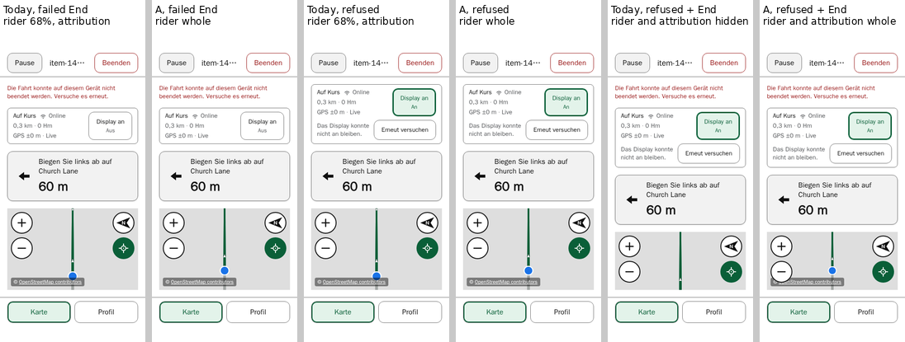
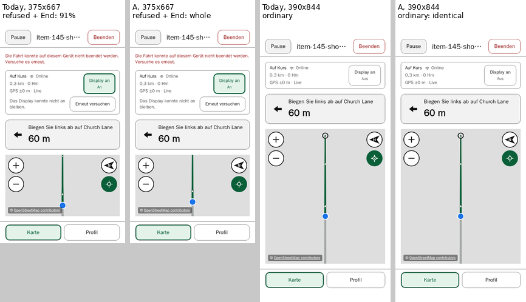

# Item 145 — rider visibility in short maps: a design proposal

**Status (14 October 2026): documentation only, awaiting the rider's review.** It is part of [item 145](../../project/backlog.md#item-145). Nothing is implemented or approved, and the queue stays 145 → 142 → 103 → 120. The four cases the [refused Screen on correction](refused-screen-on.md#what-remains-in-conflict) left open stay open: a browser result in a proposal does not close them. The text modes, the root font, Settings and the support policy are not touched.

**What this rests on.**

- **Browser evidence only,** in the CI image by digest, in Chromium and WebKit, at ordinary root text, in English and German. As before, the refusal is simulated by a wake-lock stub and the failed End by the existing clear-failure seam. Nothing here is device evidence.
- **Two builds,** both outside the repository: today's (`f07d348`, the `0.4.71` code) and a prototype of candidate A built from it.
- **The reference cases:**
  - 390×844, 375×667 and 320×693, with safe-area insets of 47/34, 20/0 and 47/34 px;
  - route riding on a trusted route 60 m before a left turn, in four states: ordinary, an ordinary failed End, refused, and refused with a failed End.

  Also measured:
  - free roam and a climb route at 320×693 in German;
  - one Planning case;
  - a synthetic 320×600 German case that holds the canvas at its floor.

- **Every comparison is between equivalent states.** Each one starts with the map ready and no imagery row in the status card. Then it takes either a fresh fix 4 m on and a proven camera settle, or, where a state must be seen before any fix, layout and camera stability.

## The rider's disc and how it is classified

The rider is a blue disc with a white outline. At the follow camera's 35° tilt its painted size varies with its height on screen, so it was measured rather than assumed. The measure is its outer painted extent, outline and antialiasing included, scanned from the projected centre in six directions clear of the route line.

- **At the follow positions,** the extent is 8.5–12.0 px in Chromium and 8.75–11.75 px in WebKit.
- **The largest anywhere,** 12.25 px, was a WebKit rider panned 135 px below the centre.

Each state is classified by a disc of that engine's largest measured extent (12.0 px in Chromium, 12.25 px in WebKit), around the projected rider. The projection is the map's own position for the rider at its latest settle, in CSS px.

- **Whole:** all of it is inside the visible map and clear of every overlay.
- **Obstructed:** it is inside the visible map but partly under an overlay, which is named.
- **Clipped:** part of it is outside the visible map, cut by its edge.
- **Hidden:** none of it is visible.

**The percentage** is the share of the disc's **area** inside the visible map and outside the overlays' boxes. It is not the earlier proposal's measure, which used a radius range of 9.4–11.25 px, so the two sets of percentages are not compared.

**Paint agreed with the geometry:**

- a whole disc's painted fill was centred on the projection to within 0.5 px, Chromium's pixel grid;
- a hidden disc showed no fill;
- an obstructed or clipped disc showed less fill than a whole one.

The exceptions were four North-up snapshots, one per size and engine, each taken after a fix that rightly moved no camera. There the dot had moved 5.3–5.5 px from its last settled projection, and every one was whole by paint.

## Today

| Size, language   | State                              | Visible map / canvas | Rider                                                              |
| ---------------- | ---------------------------------- | -------------------- | ------------------------------------------------------------------ |
| 320×693, German  | refused                            | 180 / 180            | obstructed by the attribution, 67–68%                              |
| 375×667, German  | refused, then a failed End         | 184 / 184            | obstructed by the attribution, 91%                                 |
| 320×693, German  | refused, then a failed End         | 128 / 160            | hidden by the map edge (WebKit: a 0.3% sliver); attribution hidden |
| 320×693, English | refused, then a failed End         | 149 / 160            | clipped and obstructed, 17%; attribution 84% visible               |
| 320×693, German  | for reference: a failed End        | 180 / 180            | obstructed by the attribution, 67–68%                              |
| 320×693, German  | climb route, refused, a failed End | 163 / 163            | obstructed by the attribution, 24%                                 |

In every other matrix state the rider is whole. The climb route has no manoeuvre card, and it shows that the problem is not confined to the four reference cases: it appears in any visible map shorter than about 197 px.

## The mechanism

Each point was a hypothesis until measured.

1. **The rider is placed against the canvas, not the visible map.**
   - The follow ease puts the rider 60 px below the canvas's centre (`FOLLOW_VERTICAL_OFFSET_PX` in `mapAdapter.ts`). It knows nothing of what is visible or of what lies over it.
   - After every fresh settle, the projected rider sat at the canvas's height / 2 + 60, to within 0.0000001 px.
2. **Below 160 px, the canvas extends out of sight.**
   - The immersive map keeps a 160 px `min-height` inside a content area that hides overflow. When that area is shorter, the canvas stays 160 px and its bottom is hidden.
   - At 320×693 in German, refused with a failed End, 32 px are hidden. The rider's centre, 140 px down, is then 12 px below the visible bottom.
3. **Every bottom overlay is placed against the canvas box.**
   - The attribution's containing block is MapView's own root (`position: relative`), not the canvas host; its `offsetParent` was measured as that root.
   - The paused-Follow toast and the climb cue's slot belong to the riding screen's `.ride-map-container`, beside MapView.
   - All three are positioned from the canvas box's bottom, so all three go out of sight with it. At 128 px the attribution was wholly hidden.
4. **Above the floor, the attribution crosses the rider's column.**
   - At 320 px it is 162 px wide from 8 px in, so it spans the centre. It is 18.6 px tall, 8 px above the bottom.
   - The disc reaches it once the visible map is under about 2 × (60 + 8 + 18.6 + 12) ≈ 197 px: obstructed at 180 and 184 px, clear at 201 px.
5. **A resize moves the rider with the canvas's centre, and a floor-held canvas does not move it at all.**
   - On a resize MapLibre keeps the camera's centre at the canvas's centre. With no new fix, the rider moves with that centre, to about H/2 + 62 rather than + 60 because of the tilt.
   - An existing test comment's expectation, that a resize leaves the rider where it was relative to the top, was not borne out.
   - When the canvas is held at its floor nothing resizes, so the rider stays where it was, however much of the canvas the card covers.

## Candidate A: frame the rider in the visible map

The 160 px floor stays, so the landscape contract at that floor is untouched. Candidate A has three parts, all prototyped.

1. **The bottom overlays follow the visible bottom.**
   - **The measurement:** MapView measures how much of its canvas host its clipping ancestors hide below. Only `overflow: hidden` or `clip` counts, because a scroll container or the page itself can bring a part back into view.
   - **Where the amount goes:** MapView sets it as `--map-clipped-bottom` on its own root, the attribution's containing block. It also reports it to the riding screens, which set it on `.ride-map-container` for the toast and the cue's slot.
   - **The rules:** the attribution and the toast take `bottom: calc(8px + var(--map-clipped-bottom, 0px))`. The cue's slot ends at the visible bottom, so its placement queries see the visible height.
   - **Elsewhere:** where nothing is clipped the value is 0, and nothing moves. When Planning portals the attribution into its strip, the strip's own `position: static` rule applies, and the value is never inherited there.
2. **The follow anchor is decided within the visible map.**
   - **The desired anchor** is the ordinary one, measured from the visible map instead: its centre + 60 px.
   - **Kept when clear:** if a 12 px disc there already clears the visible edges and every overlay, the anchor is kept. Every layout that needs no correction therefore keeps exactly today's camera.
   - **Otherwise it moves** to the nearest position where the disc, plus a 4 px clearance, lies inside the visible map, below its top edge, and clear of every overlay that overlaps the disc's full width: the attribution and the climb cue.
   - **A conflict:** if no such position exists, the camera keeps its current framing, and nothing is moved into an obstruction.
   - **The offset** passed to the ease is the anchor less the canvas's centre.
3. **The framing is renewed when the visible region changes, and only for the current follow.**
   - **What is observed:** the canvas host, every clipping ancestor, the attribution and the marked overlays, and an overlay arriving or leaving. A floor-held canvas does not change size while its clipping ancestor shrinks, so the ancestors are observed directly.
   - **When it acts:** once the decision has stayed the same for 120 ms. It then eases the current follow command again with the new offset; no fresh fix is needed.
   - **What it renews:** only the follow command still in force. Any other camera command ends it, as does a genuine gesture: North-up, an unanchored zoom, a fit or a recentre. Nothing is renewed unless the screen reports that it is following.

**The prototype's diff** touches:

- `mapAdapter.ts`, for an optional offset;
- `MapView.tsx`;
- a new `followFraming.ts`;
- `RidingScreen.tsx` and `FreeRoamScreen.tsx`;
- `RidingClimbCue.tsx`, for an obstacle marker;
- three CSS rules.

**Prototyping corrected itself three times,** and each correction is in the design above:

- **The 4 px clearance moved a rider that was already whole,** at 320×600 with nothing clipped. Hence the clearance is added only to a move.
- **Transient layouts made renewing at once ease the camera to a conflict and back:**
  - while End's confirmation is open, the visible map collapses to 0 px;
  - at ride start, in Chromium, it briefly measured 70 and 64 px.

  Hence the 120 ms settle, and no renewal into a conflict.

- **Counting the viewport as clipping lifted Planning's attribution onto the placement control.** Planning's map runs below the viewport while its page scrolls. Hence only hiding overflow counts.

## Measured

**The four cases and the ordinary failed End are resolved in both engines and both languages.** The last column is the rider's centre below the visible top, today and with A. Today's 140 px in the 128 px case is below the visible bottom.

| Size, language   | State                              | Visible map | Today                     | A     | Centre, today → A |
| ---------------- | ---------------------------------- | ----------- | ------------------------- | ----- | ----------------- |
| 320×693, German  | refused                            | 180         | 67–68%, attribution       | whole | 150 → 137.4 px    |
| 375×667, German  | refused, then a failed End         | 184         | 91%, attribution          | whole | 152 → 141.4 px    |
| 320×693, German  | refused, then a failed End         | 128         | hidden by the map edge    | whole | 140 → 85.4 px     |
| 320×693, English | refused, then a failed End         | 149         | 17%, edge and attribution | whole | 140 → 106.4 px    |
| 320×693, German  | a failed End                       | 180         | 67–68%, attribution       | whole | 150 → 137.4 px    |
| 320×693, German  | climb route, refused, a failed End | 163         | 24%, attribution          | whole | 141.5 → 120.4 px  |

_Chromium, CSS px, every tile at the same 0.55 scale._

**In those six states, in both engines:**

- the attribution is whole, its text inside the visible map and its link reachable at its visible centre;
- the four map controls are whole, 48 px and hit-testable;
- Screen on is whole and operable;
- the remaining distance and ascent are whole;
- the switcher is wholly on screen and operable;
- no page scrolls.

The header, card, Screen on, retry, switcher and controls keep exactly today's boxes; only the attribution and the camera differ.

**Everything else is unchanged.** In 78 of the 82 snapshots where A's framing was ordinary, every recorded box equals today's, as do the projected rider and the camera's centre, zoom, bearing and pitch. The other four are recoveries. After a correction, A eases the rider back to the ordinary 60 px point with no new fix; today it stays about 2 px off until the next fix.

**The route ahead.** Where A moves the rider, it moves it up, so less route shows ahead:

- 10.6–12.6 px less at 180–184 px of map;
- in the 128 px case the rider sits two thirds of the way down, against three quarters ordinarily.

That is the price of seeing the rider at all. The camera's zoom, tilt and bearing are unchanged.

**The allowance.** The 12 px disc A uses equals the largest outer extent measured at any follow position, 12.0 px in Chromium. It covers every tested case, with nothing to spare, and the 4 px clearance applies on every move. An implementation should use 13 px:

- **every measured ordinary case would still be kept;** the tightest would have 0.94 px to spare (320×693 English, a failed End or refused);
- **a 14 px allowance** would start to move the synthetic 320×600 case.

## Dynamics and camera intent

Measured at 320×693 and 375×667 in German, in both engines and both builds.

- **Following, with no new fix:**
  - **A renews the framing** after the refusal, after the failed End and after recovery, once for each change that moves the decision, with no fresh fix. The rider is whole at every step, and a snapshot one second later is unchanged.
  - **At 375×667** the refusal leaves 236 px, so nothing is renewed there.
  - **Today,** at 320×693, the rider is obstructed from the refusal and hidden after the failed End, fresh fix or not.
- **The canvas held at 160 px, at 320×600 in German:**
  - after the refusal the canvas reaches its floor, with 148 px visible;
  - the failed End then takes the visible map to 96 px, with the canvas unchanged;
  - A renews the framing with no fix, and the rider stays whole; today it is hidden.
- **The attribution growing,** its text doubled in place (synthetic): A renews the framing, and the rider stays whole.
- **End's confirmation held open for 1.5 s:** the visible map is 0 px, and A records a conflict without moving the camera. After Cancel the decision equals the framing already applied, so nothing eases. The camera's centre is unchanged throughout, as it is today.
- **A completed pan:**
  - first the drag, Follow off with its toast shown, the centre moved, and a stable window;
  - then the refusal, a fix, the failed End and recovery;
  - through all of them the centre stays exactly as panned (to 0.000000001°), as do zoom, bearing and pitch. Follow stays off, and A renews nothing.

  MapLibre's own resize keeps the centre, so an unchanged centre is the expected result here; a renewal would have moved it to the rider.

- **North-up:** bearing and pitch stay at 0 through the refusal, the failed End and a fresh fix, and nothing is renewed.
- **Zoom while following:** the chosen zoom, 17, is kept, Follow stays on, and A renews the framing at that zoom.

## Shared effects

- **Free roam** shares MapView and the follow camera. At 320×693 in German its map stays 342–446 px tall in the ordinary, refused and refused-with-a-failed-End states, so nothing is clipped or moved: it is identical to today.
- **Planning** never uses the follow offset, and its map is never clipped. Its attribution and placement control keep today's boxes at 320×693 in German, in both engines. Its enlarged-text strip is untouched, because the portalled attribution is `position: static`.
- **The climb cue** is placed by its slot's height, which A makes the visible height. On the climb route at 320×693 in German, refused with a failed End, the cue sits at the top. The rider fits between it and the attribution with 1.4 px to spare beyond the two 4 px clearances.
- **Existing specs, run against A's build in the CI image:** all 221 Chromium tests in 17 files passed, and all 74 WebKit smoke tests in 5 files. Among them:
  - the landscape floor and 200% checks in `ridingClimbView.spec.ts`;
  - the follow-anchor reads in `ridingCamera`, `freeRoam` and `mapImageryRecovery`;
  - `ridingStatusCardRecovery`'s map floor;
  - Planning's enlarged-text, placement and imagery specs;
  - the refused Screen on and failed-End header specs.

  This shows that A keeps the contracts those tests assert; it adds no coverage of its own.

## Conflicts and uncertainties

- **Below about 112 px of visible map, the controls themselves no longer fit.** In the synthetic 320×600 case at 96 px, the lower zoom and Follow buttons are cut, in both builds. A keeps the rider whole there, but that size is outside the reference cases: it is reported, not resolved.
- **Whether the rider fits depends on the overlays.** With the climb cue at the top and the attribution at the bottom, the 163 px climb case leaves 1.4 px of slack.
  - A shorter map with the cue present would be a conflict, in which A keeps the current framing rather than moving the rider under either overlay.
  - No reference case reached that.
- **The route ahead is shorter** wherever A moves the rider; see [Measured](#measured).
- **Device behaviour is unmeasured.** iOS fonts, the installed PWA's viewport and a real refusal may differ; nothing is claimed about the phone.
- **The prototype is not an implementation.**
  - It finds overlays through a data attribute under its parent element.
  - It records its decisions in diagnostic attributes.

  An implementation would pass the overlays explicitly and keep no such records.

## The decision needed

1. **Candidate A as the design** for the four open cases and the ordinary failed End:
   - the bottom overlays at the visible bottom;
   - the follow anchor decided in the visible map, with a 13 px disc and a 4 px clearance;
   - the framing renewed for the current follow when the visible region changes.
2. **The route-ahead trade** in those states, where the rider sits 10.6–54.6 px higher, measured against today's position.
3. **Whether the cases stay open until a device check after implementation,** as before.

**No second candidate was built.** A leaves no conflict in the reference cases. An attribution strip below the map would neither recover the controls at 96 px nor widen the climb case's slack.

## Regression coverage an implementation would need

- **Unit tests,** for the anchor decision as a pure function:
  - an unclipped map keeps 60 px exactly;
  - the disc's full width is tested against an obstacle;
  - a move adds the clearance;
  - the top edge is respected;
  - a conflict keeps the framing;
  - only hiding overflow counts.
- **Browser tests, in Chromium and WebKit:**
  - the four cases and the ordinary failed End, with the rider whole by paint and the attribution whole, its link reachable;
  - a floor-held canvas whose visible height changes with no fix;
  - recovery returning to the ordinary point;
  - End's confirmation causing no ease;
  - a completed pan, North-up and an anchored zoom each surviving a refusal;
  - Planning's attribution unchanged on a scrolled page;
  - the climb cue's clearance.
- **Negative controls:**
  - without the ancestor observation, the floor-held case fails;
  - without the settle, extra eases are recorded;
  - without the scroll-container exclusion, Planning's attribution moves.
- **Kept:**
  - the landscape floor and 200% checks in `ridingClimbView.spec.ts`;
  - the follow-anchor reads in `ridingCamera`, `freeRoam` and `mapImageryRecovery`;
  - `ridingStatusCardRecovery`'s map floor.

## Limitations

- **Browser evidence only,** at ordinary root text; the CI image's fonts are not iOS fonts.
- **The refusal and the failed End are simulated.**
- **The fixtures:** one riding fixture with an imminent turn, one climb fixture, and the sizes above. Enlarged text and landscape were checked only through the existing specs.
- **The percentages** depend on the measured disc and the overlays' boxes.
- **The screenshots are Chromium's;** WebKit's figures are in the tables.

## Reproducing

Everything is outside the repository, in `~/acn-review/item-145-shortmap/`:

- **The probe:** `probe/shortmap.spec.ts`, run in the CI image with `run.sh <name> <build>`.
- **The trees:** `trees/base` and `trees/candA`, with `candA.diff`.
- **The probe runs:**
  - `out/10-full-base`, today's build;
  - `out/11-full-candA`, candidate A as described;
  - `out/10-full-candA`, the prototype before the scroll correction;
  - `out/12-confirm-*`, the held-open confirmation.
- **The existing-spec runs:** `existing/`.
- **The scripts:** `analyse.py`, `table.py`, `equivalence.py`, `intent.py`, `slack.py` and `compose.py`.
