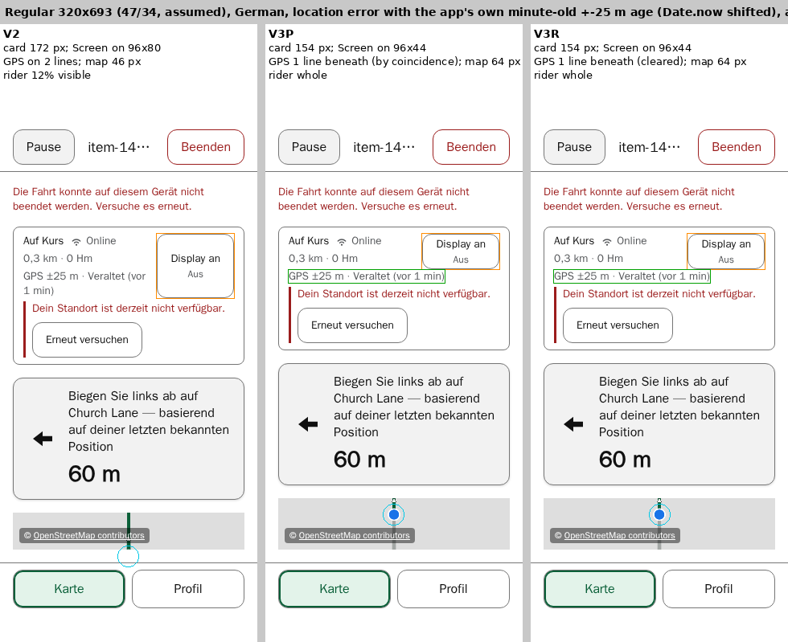
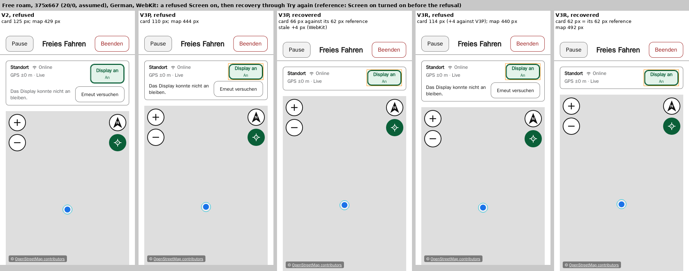
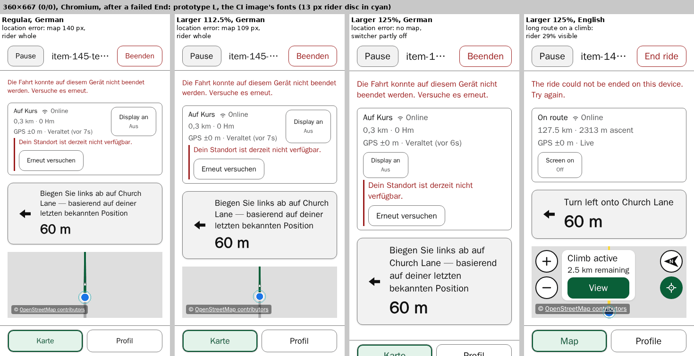
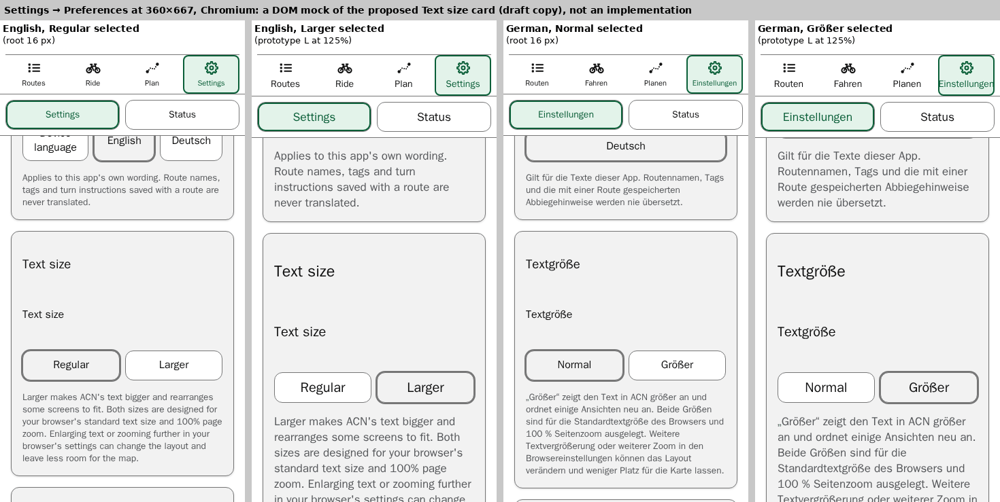

# Item 145 — Regular and Larger text modes: support range, Larger size, tests and Settings

**Status (19 October 2026): the rider chose V3R, a wrap-under Screen on, and it is implemented in `0.4.73`; CI, deployment and the installed-iPhone check are pending. The text modes themselves stay unapproved: Larger, its scale and both ranges remain provisional.** The [chosen design](#chosen-design-v3r-implemented-in-0473-19-october-2026) is current. [V2](#adaptive-screen-on-prototype-v2-16-october-2026), [V1](#screen-on-prototype-v1-16-october-2026) and the [refresh](#refresh-against-0472-16-october-2026) are kept as dated evidence, their Screen on recommendations superseded. The [13 October 2026 proposal](#the-13-october-2026-proposal-historical) below them is the unchanged historical record. P1 and P3 stay paused, item 145 stays open, and the queue stays 145 → 142 → 103 → 120.

**The direction, as given:**

- ACN stays responsive across phone sizes. The iPhone 13 is a reference, not the authority.
- **Two app-controlled text modes:**
  - **Regular**, today's presentation;
  - **Larger**, a deliberately designed layout at a chosen enlargement.
- **Ordinary riding is preserved:** as little horizontal and vertical scrolling as possible, the Map/Profile switcher on screen, the ascent visible, and Screen on one tap away.
- **The commitment.** Both modes are supported at the browser's default text size and 100% page zoom, across a documented range of portrait viewports.
  - Further browser text enlargement and page zoom stay available. Their combinations with a mode are not automatically layout requirements.
  - Pinch zoom stays available, and so do the map's own gestures.
- **P1's second selector row** is an undesirable trade-off, and is not to be built for an enlarged-text check.
- **Still unapproved:** E2, E2+N, a hidden ascent, extra Screen on taps and compound-failure exceptions.

## Chosen design: V3R, implemented in `0.4.73` (19 October 2026)

**Status: approved by the rider on 19 October 2026 and implemented in `0.4.73`, with browser evidence only; CI, deployment and the installed-iPhone check are pending** ([slice record](../../project/backlog.md#item-145-wrap-under-slice)). Only the Screen on layout is decided. Larger, its scale, both ranges, the support policy and the frozen instruction stay undecided, and item 145 stays open.

### The change

In both status cards, route riding's and free roam's, at every text size:

- **Screen on floats at the card's top right,** first in the main region, 8 px clear of the text. The status text flows beside it and, where it is longer than Screen on, continues beneath it at full width. The main region is a `flow-root` block, the text column an ordinary block, and each of its lines `width: fit-content`.
- **Its height is its content's.** The vertical padding is 2.5 px, and the existing 44 × 44 px minimum stays; in the CI fonts the button is 44 px tall, with its label and state 3.5 px inside it. Item 82's stretched, full-height button is gone.
- **Route riding's GPS line always starts beneath Screen on** (`clear: right`), so a long stale line such as "GPS ±25 m · Veraltet (vor 1 min)" takes the full width on one line. Free roam's detail line is not cleared: there it would add 18 px for nothing.
- **The refusal row** is still the wake-lock control's own element. It renders through a portal into a slot after the text (`clear: both; display: flow-root`), full width and 8 px below what precedes it. Only one row ever exists, and none renders before the slot is attached.
- **Unchanged:** the wake-lock hook and its states, the wording, `aria-pressed`, the names and focus styling; the camera and framing, the map floor, the attribution, the climb cue, the Profile selector, the frozen instruction and every other screen.

### From V3 to V3R

All three were measured outside the repository, in the CI image, in Chromium and WebKit, in English and German.

- **V3** (16 October) floated Screen on at its natural 55 px. It saved height only at 200% root text, 16 px, and left the German Regular failure unresolved: at 320×693, a location error after a failed End left 46 px of map with the rider 12% visible, because the GPS line began 44 px down, beside the button.
- **V3P** (19 October) reduced the vertical padding to 2.5 px, giving a 44 px button. The GPS line then fitted beneath on one line, the card fell from 172 to 154 px, and the German case kept 64 px of map with the rider whole. But the result rested on a coincidence of line metrics (0 px of slack in Chromium, under 1 px in WebKit), and German free roam at 375×667 in WebKit recovered from a refusal 4 px taller than before: the row's margin had collapsed through the empty slot, leaving a stale height.
- **V3R** (19 October) added the two rules above:
  - the GPS line starts beneath Screen on by rule, on one line at every button height swept from 44 to 60 px, with the card growing only by the button's extra height;
  - the contained slot removes the stale height, passing 3 of 3 where V3P failed 3 of 3. While a refusal shows in free roam it costs 4 px (a 114 px card against V3P's 110 and V2's 125).
- **Against V2,** the map gains 18 px at Regular 320×693, 21 px at 112.5% at 360×667, 11 px in free roam at 390×844, and 52 px at 200% at the imminent turn (169 against 117).





Both images are prototype renderings: the refusal message there is black, where production restores its muted colour (below).

### Decisions and explanations

- **Reading order.** A float affects only what follows it, so Screen on now comes first in the card's markup, and a screen reader reaches it before the status. Keyboard order is unchanged: Screen on was already the card's first focusable element, followed by the refusal's Try again, the location error's Try again and the imagery Retry. The status, connectivity and GPS nodes keep their identity, so their live regions behave as before, and there is still exactly one refusal alert. Focus is not moved.
- **The compact button and item 82.** Item 82's follow-up stretched Screen on down the text stack so that it sat beside the whole status rather than taking a row of its own, with no dead space beneath it. V3R keeps that saving, since Screen on stays beside the status, and lets the text use the width beneath it, which a stretched button would block. Item 82's test in `ridingWakeLock.spec.ts` now asserts a natural height: at least 44 px, the label and state inside, no taller than its content, padding and border, with the GPS line beside or beneath the button and never overlapping it.
- **Visible-text assertions.** Under a float the text column's box runs beneath Screen on, so the refusal spec's former `toggle.left >= textColumn.right` measured a box, not the text. The tests now measure each line's visible extent, using per-line `Range` rectangles, and assert that no line intersects Screen on.
- **Spacing beneath Screen on.** The GPS line's box meets Screen on's bottom edge; the visible gap between the border and the text is 4 px in Chromium and 5–6 px in WebKit. In the screenshots it reads as close but separate.
- **The refusal slot.** It clears both sides and is its own block formatting context, so the row's 8 px top margin stays inside it. Without that, WebKit kept the main region 4 px taller after the row was removed; the refusal spec's recovered-geometry comparison, made after the map is ready and its imagery settled, now catches that.
- **An intentional difference from V3R.** Portalled out of the wake-lock control, V3 and V3R's refusal message lost the muted colour it inherited from the control, rendering #101010. Production restores `--colour-text-muted` on the row (#55575a), as in `0.4.72`, and the retry keeps the base button colour. The old layout's inert flex declarations were also removed, with no change to the geometry.

### Verification, browser evidence only

- **Against V3R,** with its own probe on the production build: 52 of 52 snapshots equal in the card, the map, Screen on's box, every line's text and position, and the rider's projection. They cover the decisive German and English case, Regular 390×844 route riding and free roam, and the free-roam refusal at 375×667.
- **Negative controls,** each failing at the intended assertion:
  - without `clear: right`, the 48 px stress puts the GPS line on two lines (4 of 4);
  - without the contained slot, WebKit's recovered card differs, while Chromium passes;
  - with 8 px padding, the natural-height check fails in all 8 compact cases.
- **The tests, CI cost and evidence** are in the [slice record](../../project/backlog.md#item-145-wrap-under-slice).

### Remaining findings, kept separate

- **German map headroom.** In the CI fonts the German failed-End case keeps the rider whole down to 61 px of map, 3 px below its 64 px. iOS fonts are untested.
- **200% root text,** which remains blocking regression coverage while the support ranges are undecided. After a failed End at the imminent turn, English keeps 81 px of map with the rider 38% visible, German 45 px with the rider hidden, and Zoom out and Follow are clipped.
- **The paused-Follow toast** covers Follow at 200% before any failure, in every build alike.
- **WebKit's emulated position timestamps** are about 1,000 times the epoch milliseconds, so the app's age clamps to "0s" there; the new tests stamp positions with the page's own `Date.now`. This is a Playwright emulation observation, not an iPhone defect, and real iOS behaviour is not known.

### Evidence (local)

- The prototypes, probes, runs and images 30–53: `~/acn-review/item-145-textmodes-refresh/v3-wrap-under/` (V3), with `padding-feasibility/` (V3P) and `v3r-refinement/` (V3R) inside it.
- The production runs 500–532, the controls NC1–NC3 and the CI allocation: `~/acn-review/item-145-v3r-ship/`.

## Adaptive Screen on prototype V2, 16 October 2026

_Note, 19 October 2026: the rider chose [V3R](#chosen-design-v3r-implemented-in-0473-19-october-2026) instead, and this section's Screen on recommendation is superseded. Its measurements are kept unchanged as dated evidence._

**Status: a design prototype outside the repository, recorded for the rider's design review. Nothing is implemented or approved, and the Larger scale and both ranges remain provisional.** [V1](#screen-on-prototype-v1-16-october-2026) and the [refresh](#refresh-against-0472-16-october-2026) below are kept as dated evidence. This section is current where they differ, and corrects two of their findings.

### In brief

1. **V2 lets the content decide.** The text column's basis is `12ch`, capped at its own max-content width. Screen on stays beside the text when the column beside it is at least 12ch wide, and the text then wraps inside it. Below that width, Screen on takes its own row, as today.
2. **In every ordinary layout measured, V2 equals V1.** That covers Regular at 320×693 and 390×844, 112.5% at 360×667 and 375×667, and 125% at 360×667: 136 snapshots, in both engines and both languages. V2 keeps every V1 gain, and in Regular at 390×844 it is identical to today.
3. **At 200% root text, V2 equals today in all 20 snapshots.** V1's regression is gone: at the imminent turn the map is 117 px, the rider is whole, and all four controls are whole.
4. **Two corrections to the earlier sections:**
   - **map controls:** in a location error all four are absent by design, which the probe's summaries had reported as passing. Under V1 at 200% the lower two were clipped, which V1's section did not say;
   - **WebKit's "real" stale line never aged,** so its engine differences were differences of text.

   Neither changes V1's conclusions in ordinary layouts.

5. **The remaining conflicts are unchanged from V1.** The German Regular location error after a failed End still leaves 46 px of map, with the rider 12% visible. It stays unresolved, not an exception.

### Two corrections

**Map controls.** In route riding and free roam, Zoom in, Zoom out, North-up and Follow render only while geolocation is watching (`RidingScreen.tsx`, `FreeRoamScreen.tsx`). In a location error all four are absent by design, not clipped and not passed. From here on, each control is reported on four independent fields:

- rendered, or absent by policy;
- whole, or clipped or covered;
- the result of a hit-test at its centre;
- activation: tested or untested. Activation was untested throughout; a passing hit-test is never reported as an activation.

On those fields:

- **Images 22 and 23** show location errors, so their controls are absent by policy.
- **Image 24** shows V1 at 200% at 390×844. All four controls were rendered and all four passed the centre hit-test, but only two were whole: the lower controls were clipped.
- **The "lower controls cut" findings** — refused with a failed End below roughly 110 px of map — are rendered but clipped.
- **The 13 October measurements** say that only Follow and North-up are hidden in a location error. All four are, as the refresh already says. That historical text is left as it was.

**WebKit's stale age.** Every WebKit run showed the stale fix's age as "0s", even after the 65 s wait: "GPS ±25 m · Stale (0s ago)" and "Veraltet (vor 0s)". Chromium showed the app's own "1 min ago" and "vor 1 min". The fix comes from Playwright's geolocation emulation, and the probe does not set its timestamp. Why it does not age in WebKit is not established.

So the WebKit "real stale fix" results are measurements of a shorter line, not of the engines. To compare like with like, the app's own minute-old text was substituted in place (synchronously, then restored) for today, V1 and V2, in both engines:

- **WebKit's card and Screen on placement equalled Chromium's in every case.**
- **The substitution reproduced Chromium's real 65 s cards exactly** in every case it could be checked.
- **Today at 112.5%,** Screen on drops below the minute-old line in both engines: at 360×667 in both languages, and at 375×667 in German.

That withdraws three earlier statements:

- the refresh's "WebKit kept it beside";
- V1's WebKit figures at 112.5%;
- V1's "the engines still differ in whether the stale line wraps".

**The held roles at 112.5%, on identical text:**

- **Under V1 and V2,** held and unheld cards were identical in both engines: 187 px, and 166 px in English at 375×667.
- **In today's build,** Screen on drops either way, and the stacked card is 4 px shorter held: 229 against 233 px.
- **WebKit's shorter line suggested otherwise.** In German at 360×667 it stayed beside held and dropped unheld. That shows a hold can decide a borderline line; it does not show that one is needed. Under V1 the same difference is only a wrap, 166 against 187 px, with the rider whole either way. V2 was measured there unheld only, at 187 px.

The substitutions cover 72 cases, all passing.

### The change

On prototype L, in `src/index.css`:

```css
.ride-status-card-text {
  flex: 1 1 12ch; /* today: flex: 1 1 auto; V1: flex: 1 1 0 */
  max-width: max-content; /* added */
  min-width: 0; /* unchanged */
}
```

- **How it decides:** flexbox fills its lines using each item's hypothetical size, which here is the smaller of the text's max-content width and 12ch.
  - **Short text** always fits beside Screen on, as today.
  - **Long text** stays beside Screen on and wraps, as in V1, if the column beside Screen on would be at least 12ch wide.
  - **Otherwise** Screen on goes to its own row, as today.
- **The cap** stops the column growing past its own text. Where the text fits, only the column's own box narrows — at 390×844 in English at the imminent turn, from 230 to 121 px — and nothing visible moves.
  - In Regular at 390×844 the card pixels are identical to today's in 47 of 52 snapshots.
  - In the other five, the differences are the fix-age digit (a timing difference) and one colour level at two card corners, which also differs between today and V1.
- **The refusal row** keeps `flex: 1 1 100%`, and with it its own full-width row.
- **Untouched:** as V1. Nothing is hidden, truncated, shrunk or moved behind a tap.

The diffs are `trees/LV2-vs-L.diff`, `LV2-vs-LV.diff` and `LV2-vs-base.diff`; the JavaScript is unchanged.

### Choosing the basis

12ch is chosen from measurement, not assumed. `8rem` was the starting hypothesis.

**The sweep.** On today's build, each case's measured state was forced in place into each arrangement, then restored:

- **beside:** the text column with a zero basis;
- **stacked:** a full-width basis.

Each arrangement was measured with the rendered GPS line and with the two wider stale lines. The cases:

- **sizes:** 320×693, 360×667 and 390×844;
- **text:** 100%, 112.5% unheld, 125% held and unheld, and 150%, 175% and 200% unheld. The last three are browser-root-text proxies, outside the proposed commitment;
- **states:** the location error and the long climb route;
- English and German, in Chromium, with WebKit spot checks at 360×667 and 390×844, at 125% (held), 150% and 200%.

That is 108 cases and 324 arrangements. Sixty arrangements already fitted beside Screen on, so needed no threshold.

**What it found:**

- **At or below 10.64ch,** stacking gave the shorter card in every case.
- **At or above 12.77ch,** beside gave the shorter card in every case.
- **One width band overlaps:** 360×667 at 175%, at 10.66–10.86ch, where the content decides. German's two wider lines were 16 px shorter beside; its rendered line, and every English line, were 16–48 px shorter stacked.
- **No column fell between 10.86ch and 12.77ch,** so where the crossover lies inside that gap is not known.

**12ch** lies in that gap. It is 10.5% above the widest column where stacking was shorter (10.86ch), and 6% below the narrowest column above the overlap where beside was shorter (12.77ch). These margins hold for the measured fonts only. In the overlap band V2 stacks, as today does.

**Why `ch`:** `rem`, `em` and `ch` separated these cases identically, each overlapping only at 175%. `ch` follows the status font's own digit width, which the stale and remaining lines are mostly made of. That is reasoning: other fonts were not measured.

In these fonts 12ch is about 6.1rem. **Where the proposed ranges begin, the column beside Screen on is well above that:** 9.9–10rem in Regular at 320 px, and 10.6–11.1rem at 112.5% at 360 px. So are two narrower points outside the ranges: 8.4rem at 112.5% at 320 px, and 7.15rem at 125% unheld at 320 px. At 200% at 390×844 the column would be 5.31rem (10.43ch), so V2 stacks, as today does.

### Results

Map heights in px, **before → after a failed End**. The rider is whole unless stated, and controls are reported on the fields above. Chromium's heights; WebKit's were the same, except for the minute-old line, whose cards were checked by substitution.

| State                                                      | Today                                                          | V1                                                                   | V2                     |
| ---------------------------------------------------------- | -------------------------------------------------------------- | -------------------------------------------------------------------- | ---------------------- |
| Regular 320×693, location error, minute-old fix, German    | 53 → 1, **hidden**; card 217 px, Screen on below               | 98 → **46, 12% visible**; card 172 px                                | As V1                  |
| Regular 320×693, the same, English                         | 74 → **22, 12% visible**                                       | 119 → 67                                                             | As V1                  |
| Regular 320×693, long climb route, English                 | 190 → **138, 38% visible**; card 143 px                        | 235 → 183; card 98 px                                                | As V1                  |
| Regular 320×693, refused, then recovery                    | Refusal row full width (262 px); recovered card 80 px          | Identical                                                            | Identical              |
| 112.5% unheld, 360×667, minute-old fix, both languages     | 100 → 42, **hidden**; card 233 px                              | 146 → 88; card 187 px                                                | As V1                  |
| 112.5% unheld, 375×667, minute-old fix, German             | 80 → 22, **hidden**                                            | 126 → 68                                                             | As V1                  |
| 125% held, 360×667, minute-old fix, German / English       | 31 → 0 / 81 → 19, **hidden**                                   | 71 → 9 / 121 → 59, **hidden**                                        | As V1                  |
| 125% held, 360×667, long climb route, English              | 214 → **152, 29% visible**                                     | 254 → 192                                                            | As V1                  |
| 200% unheld, 390×844, imminent turn, before any failure    | 117; card 230 px, stacked; controls 4 rendered, 4 whole, 4 hit | 97, **hidden**; card 250 px; controls 4 rendered, **2 whole**, 4 hit | **As today**           |
| 200% unheld, 390×844, after a failed End, English / German | 29, 36% visible / 0; controls 4 rendered, 0 whole              | 9, **hidden** / 0                                                    | **As today**           |
| 200% unheld, 390×844, location error                       | No map; cards 404 / 368 px; controls absent by policy          | No map; cards 424 / 388 px                                           | **As today**           |
| Regular 390×844 reference, 52 snapshots                    | —                                                              | Identical to today                                                   | **Identical to today** |

- **Throughout:** every status line stayed inside the card and clear of Screen on, and Screen on's computed treatment was identical in all 326 comparisons with today and V1. The refusal row stayed full width, at 262 and 332 px, and its retry stayed whole. Recovery left the failed End's error in place, and the recovered card equalled the Screen on reference: 80 px.
- **The switcher and the attribution:** V2 kept both wherever today does. Where V2 differs from today, it is better: at 125% in German after a failed End, the switcher goes from partly off screen to on screen, and nine location-error snapshots after a failed End regain the whole attribution. At 200% in a location error, the switcher is off or partly off screen in today's build and V2 alike.
- **No page scroll** was added: no V2 snapshot scrolled, horizontally or vertically.
- **The visual trade-off is V1's:** where Screen on stays beside a long line, the line wraps at a word boundary, for example "(vor / 1 min)". Images 26 and 27 show it.

**Images,** local only, in `~/acn-review/item-145-textmodes-refresh/images/`. Each is labelled with its scale, held roles, language and state:

- `25-v2-200-390x844-imminent-turn.png`: today, V1 and V2 at 200%;
- `26-v2-regular-320x693-real-stale.png`: Regular, the minute-old fix after a failed End, today and V2, in German and English;
- `27-v2-112-360x667-real-stale.png`: the same at 112.5%, with nothing held.

### Remaining conflicts and separate questions

- **Regular at 320×693, a German location error after a failed End:** 46 px of map, with the rider 12% visible, in both engines. It is the same under V1 and V2.
  - What remains is the error row, the four-line frozen instruction and the End error together.
  - It is inside the proposed Regular range. It stays unresolved, and no exception is assumed.
- **125% at 360×667:** a minute-old location error still hides the rider after a failed End. Under V1, refused with a failed End still clipped the lower controls; V2 was not run in that state.
- **Below roughly 110 px of visible map,** the lower controls are rendered but clipped. This is unchanged by V2.
- **At 200%, outside the proposed commitment,** today's own losses are unchanged: no map in a location error, and after a failed End no control whole.
- **The frozen instruction's "— based on your last known position"** is reported only; its wording is unchanged here. It costs:
  - +42 px in Regular at 320 px (German from 2 to 4 lines, English from 1 to 3);
  - +21–42 px at 360–390 px;
  - +24 px (German) and +48 px (English) at 112.5%;
  - +54 px at 125%.

  The stale GPS line and the error row already say that the position is old. Two compact options, for design:
  - a single short qualifier beside the distance, such as "last known position", where that line has room;
  - or the qualifier stated once in the location-error row.

  Either would recover most of that height at 320 px. This is an estimate, not rendered.

- **The Settings mock (image 11) is conceptual.** Its duplicated label and its gaps are not an approved layout.
- **Not measured:**
  - a refused Screen on together with a location error;
  - a card without Screen on, where Wake Lock is unsupported. V2 would narrow only the column's box there, but this is reasoned, not measured;
  - instructions longer than the fixture's;
  - widths between the named sizes;
  - iOS fonts.

### Recommendation

- **V2, in place of V1, as the Screen on correction, in Regular first.**
  - It keeps every V1 gain measured.
  - It leaves 200% exactly as today.
  - In Regular at 390×844 it is identical to today.
  - Its one cost is V1's: wrapped status lines where Screen on stays beside a long line.
- **Larger at 112.5%, provisional.** Nothing is held. The commitment stays provisional, and the ranges remain unapproved.
- **Larger's proposed range, 360–440 × 667–956 px,** at the measured insets, still **excludes the 320 px layout used as the enlarged-Display-Zoom reference**. That exclusion is not accepted here; it is the rider's decision.
- **Regular's proposed range, from 320×693,** includes the German location-error conflict above.
- **The defaults stand:** the relative root rule, and the Settings card after Language.

| Choice                              | Recommendation                                                                                  | Trade-off                                                                        |
| ----------------------------------- | ----------------------------------------------------------------------------------------------- | -------------------------------------------------------------------------------- |
| 1. The Screen on correction         | V2, in Regular, before the modes                                                                | Wrapped status lines; a basis chosen from CI fonts, with margins of 10.5% and 6% |
| 2. Larger's size                    | 112.5%, nothing held, provisional                                                               | A modest enlargement; 125% would need a taller corner and both holds             |
| 3. Larger's range                   | 360–440 × 667–956, provisional                                                                  | Excludes the 320 px enlarged-Display-Zoom reference, which is not accepted here  |
| 4. Regular's range and its conflict | From 320×693, with the German location error after a failed End left open for a design decision | 46 px of map and the rider 12% visible, in a compound failure at 320 px          |
| 5. The frozen instruction           | A compact qualifier, for design                                                                 | Wording changes need their own review                                            |

### Verification for an implementing slice

- **Every current blocking test is kept.** The 141 existing blocking cases that passed against V1 were rerun against V2, unchanged.
  - 59 passed at once.
  - In the 82-case Chromium set, the first run failed four camera and imagery-recovery tests: three by the 30 s timeout, one on the camera anchor after a recovery. That whole run was about twice as slow as the others: a median test took 14.8 s against 6.9–8.7 s, on a shared host whose load average was 61–64 just afterwards.
  - The four failures did not reproduce. They passed in three isolated repeats each against today and V2 (12 of 12 per build), and the full 82-case set passed against both builds in back-to-back reruns, in 610 s and 609 s of summed test time.
  - The cause is not established. No V2 mechanism was found: the four tests assert the camera, not the status card. The failing run's artefacts are kept (`out/127-…`).
- **Focused assertions,** in the existing range specs:
  - Screen on beside a realistic long line at the proposed reference corners: Regular 320×693, and 112.5% at 360×667 and 375×667;
  - at 200% at 390×844, no regression against today: the rider's visibility, the card's height, and the controls whole;
  - the refusal row full width through recovery;
  - the ordinary geometry unchanged at 390×844: Screen on's box and every line.
- **A deterministic minute-old line,** chosen then. The probe's real line needed 65 s in Chromium, and WebKit's never aged.
- **Negative controls:**
  - `flex: 1 1 auto`, today's rule, should fail the beside assertion;
  - `flex: 1 1 0`, V1's rule, should fail the 200% assertion.
- **No timing campaign is needed.** The added cases follow the refresh's estimate.
- No phone check is requested here.

### Limitations

- The 112.5%, 125% and 200% figures come from browser root-text proxies, not native zoom.
- The insets are assumed, except 390×844's.
- The fonts are the CI image's. iOS fonts will wrap at different points, and the 12ch margins hold for the measured fonts only.
- Activation was untested throughout.

**Evidence,** outside the repository in `~/acn-review/item-145-textmodes-refresh/`:

- `trees/LV2` and its three diffs;
- the sweep, runs `out/100-…` to `out/105-…`, summarised in `out/sweep-v2.txt` by `scripts/sweep_v2.py`;
- V2's runs, `out/110-…` to `out/117-…`;
- the substitutions, `out/120-…` to `out/123-…`;
- the existing specs against V2, `out/124-…` to `out/128-…`, and the reruns `out/129-…` to `out/132-…`;
- `scripts/compare_v2.py`, `v2_match.py`, `lines11.py` and `cardpixels.py`;
- `images/25-…` to `images/27-…`.

## Screen on prototype V1, 16 October 2026

**Status: a design prototype outside the repository, recorded here for the rider's design review. Nothing is implemented or approved, and the Larger scale and both ranges remain provisional.** The [refresh](#refresh-against-0472-16-october-2026) below is kept as dated evidence; this section says where V1 changes its conclusions.

_Note, later on 16 October 2026: [V2](#adaptive-screen-on-prototype-v2-16-october-2026) above supersedes this section's recommendation. It corrects four statements here, each marked: WebKit's stale line, the engines' difference, the held roles in WebKit, and V1's map controls at 200%. The rest is unchanged._

_Note, 19 October 2026: V2's recommendation is superseded in turn by [V3R](#chosen-design-v3r-implemented-in-0473-19-october-2026)._

### The change

One declaration in `src/index.css`:

```css
.ride-status-card-text {
  flex: 1 1 0; /* today: flex: 1 1 auto */
}
```

- **Why it holds:** today the text column's basis is its max-content width, so a line too long to sit beside Screen on wraps the whole control onto a row of its own. With a zero basis, the column and Screen on always share the first row, and the text wraps inside its column.
- **The refusal row** keeps `flex: 1 1 100%`, so it still takes a full-width row of its own. That full-width row is what P2's `nowrap` broke.
- **Where the text already fits,** the column grows to exactly today's width.
- **Untouched:**
  - Screen on's rules, labels and states, and the refusal row;
  - the camera, framing, the map floor, the attribution and the climb cue;
  - the selector and the copy.

  Nothing is hidden, truncated, shrunk or moved behind a tap.

### How V1 was measured

- **The builds:**
  - **today:** prototype L, which in Regular equals `0.4.72` box for box;
  - **V1:** L plus the declaration. Its JavaScript is unchanged.

  The baseline is `669143dae7013f15fbe1cfb79d3528309c1615e8`, whose application is `7e6246a`'s.

- **The refresh's probe, unchanged,** with the same fixtures, the long route's asserted prerequisites, settled imagery, fresh-fix settles, paint against the current projection, and the 13 px disc with 4 px on corrective moves. Its additions:
  - **recovery from a refusal:** only the refusal is cleared. Its own alert goes, Screen on is pressed, and the failed End's error is still shown. The recovered card is compared with the imminent turn after a failed End with Screen on turned on;
  - each status line's lines and height, and whether its text lies inside the card and clear of Screen on;
  - the refusal row's width against the main row;
  - Screen on's computed treatment.
- **The realistic stale state:** a last fix at ±25 m, with the location error left running 65 s. The app itself shows "GPS ±25 m · Veraltet (vor 1 min)" / "GPS ±25 m · Stale (1 min ago)", identical in every pair compared. _(Corrected later on 16 October 2026: in Chromium only. WebKit's age stayed at "0s", so the WebKit figures in the 112.5% table measured a shorter line; see [V2's corrections](#two-corrections).)_
- **Insets:** 320×693 47/34, 360×667 0/0, 375×667 20/0 (the proposed lower height), 390×844 47/34. All are assumed except 390×844's.
- **Volume:** 180 probe cases in Chromium and WebKit, in English and German, plus 141 cases of existing blocking specs. The real-stale cases ran at four workers, since they mostly wait.

### Results

Map heights in px, **before → after a failed End**; the rider is whole unless stated.

**Regular, 320×693:**

| State                                            | Today                                                    | V1                                                                |
| ------------------------------------------------ | -------------------------------------------------------- | ----------------------------------------------------------------- |
| Location error, real stale fix, German           | 53 → 1, **hidden**; card 217 px, Screen on below         | 98 → **46, 12% visible**; card 172 px, the GPS line on two lines  |
| Location error, real stale fix, English          | 74 → **22, 12% visible**; card 217 px, Screen on below   | 119 → 67, **whole**; card 172 px, the GPS line on two lines       |
| Location error, the probe's short line, German   | 53 → 1, **hidden**; card 217 px                          | 98 → **46, 12% visible**; card 172 px                             |
| Long climb route, English                        | 190 → **138, 38% visible**; card 143 px, Screen on below | 235 → 183, **whole**; card 98 px, the remaining line on two lines |
| Long climb route, German; imminent turn; refused | Screen on beside                                         | **Identical to today**                                            |

- **Refused,** in both languages and engines:
  - the refusal row spans the main row's full 262 px, with the retry whole and at least 44 px;
  - recovery left the failed End's error in place, and the recovered card equals the Screen on reference: 80 px of card, with 180 px of map in German and 201 px in English.

**Larger at 360×667 (0/0) and 375×667 (20/0):**

| State                                       | 112.5% today                                             | 112.5% V1                                                     | 125% today                        | 125% V1                                 |
| ------------------------------------------- | -------------------------------------------------------- | ------------------------------------------------------------- | --------------------------------- | --------------------------------------- |
| Real stale fix, German, 360×667             | 100 → 42, **hidden**; card 233 px (both engines, unheld) | 146 → 88, whole; card 187 px (WebKit: 167 → 109, card 166 px) | 31 → 0, **hidden**                | 71 → **9, hidden**                      |
| Real stale fix, English, 360×667            | 100 → 42, **hidden** (Chromium); WebKit 167 → 109        | 146 → 88, whole (WebKit 167 → 109)                            | 81 → 19, **hidden** (held)        | 121 → **59, hidden** (held or not)      |
| Real stale fix, German, 375×667             | 80 → 22, **hidden** (Chromium); WebKit 147 → 89          | 126 → 68, whole (WebKit 147 → 89)                             | —                                 | —                                       |
| Long climb route, English, 360×667          | 292 → 234                                                | Identical                                                     | 214 → **152, 29% visible**        | 254 → 192, **whole**; card 158 → 118 px |
| Location error, short line, German, 360×667 | 167 → 109                                                | Identical                                                     | 31 → 0, **hidden**                | 71 → **9, hidden**                      |
| Refused, German, 360×667                    | 216 → 158                                                | Identical; recovery equal                                     | 167 → 105, **lower controls cut** | Unchanged                               |

- **At 112.5%, V1 removes every Screen on drop measured,** in both engines, at the proposed lower corner and the proposed lower height. Every state measured keeps the rider whole.
  - The engines still differ in whether the stale line wraps: Chromium on two lines, card 187 px; WebKit on one, card 166 px. Screen on and the rider are unaffected. _(Withdrawn later on 16 October 2026: WebKit's line read "0s". With the same minute-old text, both engines gave 187 px.)_
- **At 125%, V1 resolves the long route but not the location error.** With the real stale fix the rider is still hidden after a failed End in both languages, and the refused case still cuts the lower controls.

**The held roles:**

- **112.5% with V1:** held and unheld were identical in every state compared. Nothing needs holding. _(Corrected later on 16 October 2026: not on WebKit's German "0s" line at 360×667, 166 px held against 187 px unheld, with the rider whole either way. With the same minute-old text, held and unheld were identical in both engines.)_
- **125% with V1:** Screen on's hold still matters. With the probe's short line, the English location error kept the rider at 82 px held, but lost it at 59 px unheld. The refresh's −0.9 px selector overflow, unheld at 360 px, also stands.

**The ordinary reference, Regular at 390×844:** the imminent turn with Screen on, the GPX notice, free roam, the location error, and refused with recovery. **All 52 snapshots were identical** to today, box for box, in both engines. Screen on's computed treatment was identical in all 76 comparisons. Where text wraps, Screen on only stretches to the column's height, 80 px against 62 px, keeping its labels and its minimum.

**The existing blocking tests:** all 141 cases passed against V1 unchanged.

- in Chromium: `ridingWakeLock`, `ridingStatusCardRecovery`, `ridingMapProfileViews`, `ridingRefusedScreenOn`, free roam's Screen on layout, `ridingClimbView`, `ridingNextManoeuvre`, `ridingCamera`, `mapImageryRecovery`, `ridingSelectedFeatureSummary`, `endRideFailureHeader` and `ridingVisibleMapFraming`;
- in WebKit: the last three of those that are smoke specs.

With no failure, no fallback is needed, and none is recommended.

**200% root text, outside the proposed commitment, at 390×844 at the imminent turn:**

- V1 keeps Screen on beside the text and the text wraps, so the card grows from 230 to 250 px and the map shrinks from 117 to 97 px.
- The rider is hidden before any failure, where today it is whole. After a failed End, English goes from 36% visible to hidden.
- _Added later on 16 October 2026:_ before any failure, only two of the four map controls were whole. The lower two were clipped, although all four passed the centre hit-test (image 24). Today and V2 keep all four whole.
- No current blocking test detects this.

**The visual trade-off.** Wrapping happens at word boundaries inside the column: "ascent" or "ago)" can sit alone on a second line. Every line stayed inside the card and clear of Screen on, in every case.

### Remaining conflicts and unmeasured conditions

- **Regular at 320×693, a German location error after a failed End:** 46 px of map, with the rider 12% visible, in both engines. Screen on no longer causes it. What remains is the error row, the four-line frozen instruction and the End error together. It is inside the proposed Regular range, and no exception is assumed.
- **125% at 360×667:** a realistic location error still hides the rider after a failed End, and refused with a failed End still cuts the lower controls.
- **Unchanged and outside the proposed ranges:** the climb cue at 320 px at 112.5%, and the lower map controls cut below roughly 110 px of map.
- **Not measured:**
  - a refused Screen on together with a location error;
  - longer instructions;
  - widths between the named sizes;
  - iOS fonts. The wrap points will differ there, but the toggle can no longer drop.

### Revised recommendation

- **V1, as the Screen on correction, in Regular first.** It changes today's layout only where a line would otherwise push Screen on below. Its costs:
  - wrapped status lines;
  - the 200% effect above, which is outside the proposed commitment.
- **Larger at 112.5%, with nothing held.** With V1, it no longer sits at an edge: every state measured at 360×667 and 375×667 keeps the rider whole in both engines. V1 doesn't change the comparison with 125%, which still loses the rider at 360×667 and needs both holds.
- **Larger's range, provisional: 360–440 × 667–956 px, at the measured insets.** It **excludes the 320 px layout used as the enlarged-Display-Zoom reference.** Whether that is acceptable is the rider's decision.
- **Regular's range, provisional: from 320×693.** That includes the German location-error conflict above.
- **The defaults stand:** the relative root rule and the Settings card. Nothing here contradicts them.

### Choices still requiring approval

| Choice                              | Recommendation                                                                                         | Trade-off                                                                                                      |
| ----------------------------------- | ------------------------------------------------------------------------------------------------------ | -------------------------------------------------------------------------------------------------------------- |
| 1. V1                               | Approve, in Regular, before the modes                                                                  | Wrapped status lines; 200%, outside the proposed commitment: 20 px less map, rider hidden at the imminent turn |
| 2. Larger's size                    | 112.5%, nothing held                                                                                   | A modest enlargement; 125% would need a taller corner and both holds                                           |
| 3. Larger's range                   | 360–440 × 667–956, provisional                                                                         | Excludes the 320 px enlarged-Display-Zoom reference                                                            |
| 4. Regular's range and its conflict | From 320×693; the German location error after a failed End accepted as reported, or a design requested | 46 px of map and the rider 12% visible, in a compound failure at 320 px                                        |
| 5. The 200% presentation            | Accept V1's effect as reported, outside the proposed commitment                                        | Keeping today's 200% layout would need a separately measured variant                                           |

### Implementation sequence and verification

1. **The V1 slice, in Regular:**
   - the one declaration;
   - every current blocking test kept;
   - in the existing range specs, assertions that Screen on stays beside a long realistic line, that the refusal row stays full width through recovery, and that the ordinary geometry is unchanged;
   - a deterministic long-line fixture, to be chosen then: the probe waited 65 s for its real stale fix;
   - a negative control restoring `flex: 1 1 auto`.

   When it is implemented, an ordinary stationary phone check, with nothing manufactured and no VoiceOver.

2. **Then the modes at the chosen size,** as in the refresh's sequence.

No timing campaign is needed. The added cases follow the refresh's estimate.

**Evidence and images,** outside the repository in `~/acn-review/item-145-textmodes-refresh/`:

- `trees/LV` and `LV-vs-L.diff`;
- runs `out/70-…` to `out/95-…`;
- `scripts/compare_v1.py`;
- `images/20-…` to `images/24-…`.

## Refresh against `0.4.72`, 16 October 2026

_Note, later on 16 October 2026: the Screen on prototypes above, [V2](#adaptive-screen-on-prototype-v2-16-october-2026) and [V1](#screen-on-prototype-v1-16-october-2026), revisit this section's conflict 1 and its choices 1–6. V2 also corrects this section's WebKit finding, marked below; the text is otherwise unchanged._

_Note, 19 October 2026: the rider chose [V3R](#chosen-design-v3r-implemented-in-0473-19-october-2026) for Screen on, so this section's conflict 1 and choice 1 are superseded; its other choices stay undecided._

**Status: documentation only, for the rider's design review. Nothing is implemented or approved.** Where this section and the [13 October proposal](#the-13-october-2026-proposal-historical) differ, this section is current. The 13 October measurements are kept unchanged below as the historical record.

### In brief

1. **The shipped slices resolved two defects, and made most of the old rider marks obsolete.**
   - The refused retry is whole in every refused state measured (`0.4.71`).
   - The selector's German labels fit at 320 px at ordinary text (`0.4.70`, accepted on the phone).
   - The concise notice replaced the GPX notice's first ten seconds.
   - Framing re-measured every rider mark, and many former ✗/◐/? cases now keep the rider whole.

   Obsolete is not resolved: the conflicts below were found by re-measuring, and 150% Page Zoom stays an open device finding.

2. **Regular today,** from 360×667 to 390×844, keeps the rider whole, the switcher on screen and Screen on beside the text in every rendered state measured. Only a stale line as wide as "±150 m · Veraltet (vor 10 min)" drops Screen on there, in German at 360 px. At 320 px wide it does not:
   - in German, a location error hides the rider;
   - with a realistic stale fix, the English rider is clipped after a failed End;
   - on a long trusted route during a climb, a failed End leaves the rider under the attribution.
3. **125% fails at its proposed corner.** At 360×667 and 375×667 it loses the rider in location errors and on the long climb route, and cuts the lower map controls after a failed End while refused. It is clean only from a taller corner: 360×780, and 390×844.
4. **112.5% is the stronger candidate.** With the probe's short stale line, "±0 m" and a few seconds old, every state measured from 360×667 to 440×956 kept the rider, the switcher, Screen on beside the text and the selector in one row, in both engines and languages.

   **It is at an edge, though.** A real, minute-old ±25 m fix, "GPS ±25 m · Veraltet (vor 1 min)", pushes Screen on below the text in Chromium at 360×667 (both languages) and 375×667 (German), and the rider is then lost after a failed End. WebKit kept it beside. _(Corrected later on 16 October 2026: WebKit's line read "vor 0s". With the same minute-old text, WebKit drops Screen on in the same cases; see [V2](#two-corrections).)_

5. **The common mechanism is Screen on dropping below a long status line.** The card grows 55–70 px. P2, re-checked because its 12 October rejection rested partly on the refused layout `0.4.71` replaced, keeps Screen on beside the text in every stale variant. It still breaks the refused row, so P2 as written stays rejected. A variant scoped away from the refusal was not measured, and is a design question.
6. **At 112.5% nothing needs holding at Regular size.** Held and unheld were identical from 360 px. At 125% both holds are load-bearing.
7. **Re-measured or reconfirmed:**
   - the relative root rule;
   - the non-riding screens at 360 px;
   - Planning's item 114 layout, which engages at 360×667 in either Larger;
   - the Settings card, as a mock.
8. **Tests:** keep every current blocking test and add about 17 cases per engine. Under Candidate B the heaviest job is estimated at about 963 s. Retiring 200% layout tests is a separate, unapproved option.

### Baseline and method

- **The baseline:**
  - `669143dae7013f15fbe1cfb79d3528309c1615e8`, equal to `origin/main` after a fetch, version `0.4.72`;
  - its application is `7e6246a`'s, since `669143d` changed CI and documentation only.
- **Prototype L,** outside the repository, CSS only:
  - `:root[data-text-size="larger"] { --text-scale: 1.25; font-size: calc(var(--text-scale) * 100%) }`;
  - the Screen on toggle and the active selector's labels held at Regular through `calc(… / var(--text-scale))`;
  - a probe-only attribute that releases the hold.

  Its JavaScript is identical to today's, and **Regular on L equals today's build box for box** in all 24 compared snapshots, in both engines.

- **The probe:**
  - derived from the [short-map probe](short-map-rider-visibility.md), keeping its paint scan, settle, camera reads and measurements;
  - the 13 October probe's location-error hook and selector reading;
  - the CI image by digest, at two workers.
- **The mode** is set the way an implementation would set it, through the attribute and `--text-scale`, with no inline root size. The computed root of 18 or 20 px is a precondition, and a deliberately wrong scale failed it.
- **The rider** is classified by the approved 13 px disc against the visible map and every overlay. A kept position needs the whole disc clear; a corrective move needs 4 px of clearance.
- **Scenarios,** each before and after a synthetic failed End:
  1. a trusted route at an imminent turn (60 m);
  2. the same route imported, with the concise notice;
  3. a location error;
  4. a refused Screen on;
  5. a long trusted route.
- **The long route's prerequisites,** asserted before anything is measured:
  - trusted guidance at imminent urgency;
  - a remaining line of 100 km or more with a four-digit ascent;
  - the active-climb cue;
  - the selector's Climb slot.

  **One correction:** the app prints the ascent without a thousands separator, "127,5 km · 2313 Hm", so 13 October's "2.345 Hm" overstated the width a little.

- **Staged,** by the reviewer's correction:
  - first, 125% at Larger's proposed lower corner, and Regular at its own, in the previously conflicting states;
  - then, only where a result could change a recommendation: 112.5%, other sizes, the unheld comparison, the inset sensitivity, the realistic stale lines and P2.

  That came to 372 riding cases, 19 controls and 20 other cases. Stages 2 to 5 were added only where an earlier stage changed the comparison, in place of the 488-case cross-product first planned.

- **Positive control:** the `0.4.71` build, refused at 320×693 in German, classified the rider as 66% visible, and 1% after a failed End. Today's build keeps it whole there.
- **Engines:** Chromium and WebKit agreed in every compared snapshot except the realistic stale line, described below. _(Corrected later on 16 October 2026: that exception was WebKit's line reading "0s"; with the same text the engines agreed.)_
- **Insets are assumptions,** except 390×844's 47/34:
  - 360×667 is measured at 0/0, because only Android-class devices have 360 CSS px widths, as for 360×780;
  - its decisive states were also measured at 20/0;
  - a support claim holds for the inset pairs measured, and a larger top inset costs its own height.

### What the shipped slices resolved, and what is only obsolete

| 13 October finding                                        | Now                                                                                                                                                            |
| --------------------------------------------------------- | -------------------------------------------------------------------------------------------------------------------------------------------------------------- |
| The refused retry cut off, in Regular                     | **Resolved by `0.4.71`.** Whole and at least 44 px in every refused state measured, both modes. Decision 5's containment and prototype T's P3 are superseded   |
| The selector overflowing at 320 px in German              | **Resolved at ordinary text by `0.4.70`**, accepted on the phone: 1.8 px of room for `Gesamt` at 320 px in CI fonts. The **150% Page Zoom finding stays open** |
| The ✗/◐/? rider marks                                     | **Obsolete:** they predate framing, and some were unquantified. Re-measured below; several conflicts remain                                                    |
| The GPX notice's first ten seconds                        | **Obsolete:** the concise notice is one line. At 320×568, 241 → 189 px, with the rider whole                                                                   |
| "From 360×780 and 390 px, Regular meets the requirements" | **Re-measured:** Regular is clean from 360×667 in the states rendered. A German stale line of "±150 m … 10 min" still drops Screen on at 360 px                |
| The long line, predicted                                  | **Rendered:** the predictions held (Regular at 320 px and 125% at 360 px in English wrap; 112.5% at 360 px fits)                                               |
| The relative root rule                                    | **Valid**, and reconfirmed on L: a 16, 24 or 32 px browser default gives a Larger root of 20, 30 or 40 px                                                      |
| The non-riding screens, the font roles                    | **Valid**: their code is unchanged since then. Spot checks at 360 px follow                                                                                    |
| P2, rejected                                              | **Partly obsolete:** its main reason was the old refused layout. Re-checked below; it still breaks the refused row                                             |

### Current measurements

Map heights in px, German / English, **before → after a failed End**. The rider is whole unless stated. "Screen on below" means the toggle dropped under the text.

**Regular, today's build:**

| Size (insets)   | Imminent turn         | Location error                                 | Refused                                          | Long route on a climb                                      |
| --------------- | --------------------- | ---------------------------------------------- | ------------------------------------------------ | ---------------------------------------------------------- |
| 320×568 (20/0)  | 168 → 116 / 189 → 137 | **0, switcher partly off** / 73 → **21, 12%**  | 116 → 64 / 137 → 85, **Zoom out and Follow cut** | 168 → **116, 28%** / **126 → 74, hidden**, Screen on below |
| 320×693 (47/34) | 232 → 180 / 253 → 201 | **53 → 1, hidden**, Screen on below / 137 → 85 | 180 → 128 / 201 → 149                            | 232 → 180 / 190 → **138, 38%**, Screen on below            |
| 360×667 (0/0)   | 287 → 235 / 308 → 274 | 192 → 140 / 213 → 179                          | 235 → 183 / 256 → 222                            | 287 → 235 / 308 → 274                                      |
| 375×667 (20/0)  | —                     | 172 → 120 / 193 → 159                          | 236 → 184 / 236 → 202                            | —                                                          |

The imported route with the concise notice kept the rider at 320×568 and 320×693: 241 → 189 and 305 → 253 px in both languages. In a location error, all four map controls are hidden by design, since they render only while geolocation is watching.

**Larger, prototype L:**

| Size (insets)   | Mode           | Imminent turn         | Location error                                              | Refused                                       | Long route on a climb                                           |
| --------------- | -------------- | --------------------- | ----------------------------------------------------------- | --------------------------------------------- | --------------------------------------------------------------- |
| 320×693 (47/34) | 112.5%         | 213 → 155, both       | not measured (Regular already conflicts)                    | 132 → 74 / 161 → 103, **lower controls cut**  | 213 → **155, 18%** / **150, 34% → 92, hidden**, Screen on below |
| 360×667 (0/0)   | 112.5%         | 268 → 210 / 292 → 234 | 167 → 109, both                                             | 216 → 158 / 240 → 182                         | 268 → 210 / 292 → 234                                           |
| 360×667 (0/0)   | 125%           | 250 → 188 / 277 → 215 | **31 → 0, switcher partly off**, Screen on below / 144 → 82 | 167 → 105, **lower controls cut** / 223 → 161 | 250 → 188 / 214 → **152, 29%**, Screen on below                 |
| 375×667 (20/0)  | 112.5%         | 248 → 190 / 272 → 214 | 147 → 89, both                                              | 196 → 138 / 220 → 162                         | 248 → 190 / 272 → 214                                           |
| 375×667 (20/0)  | 125%           | —                     | 97 → **35, hidden** / 124 → **62, hidden**                  | 176 → 114 / 203 → 141                         | —                                                               |
| 360×780 (0/0)   | 125%           | 363 → 301 / 390 → 328 | 144 → 82 / 257 → 195                                        | 280 → 218 / 336 → 274                         | 363 → 301 / 327 → 265, Screen on below                          |
| 390×844 (47/34) | 112.5%, unheld | —                     | 263 → 205 / 287 → 250                                       | 312 → 254 / 336 → 299                         | 364 → 306 / 388 → 351                                           |
| 390×844 (47/34) | 125%           | —                     | 240 → 178, both                                             | 292 → 230 / 319 → 257                         | 346 → 284 / 373 → 311                                           |
| 440×956 (59/34) | 112.5%, unheld | —                     | 363 → 305 / 416 → 379                                       | 436 → 378 / 436 → 399                         | 488 → 430 / 488 → 451                                           |

- **The inset sensitivity:** at 360×667 with 20/0, the imminent turn and the refused state stayed whole at 112.5%. At 125%, refused with a failed End left 85 px of map in German, again cutting the lower controls.
- **Held and unheld at 112.5%** were identical at 360×667 and 375×667, map and card alike.
- **At 125% unheld, at 360×667:**
  - the English location-error card grew from 174 to 244 px, and the rider was hidden after a failed End;
  - German `Gesamt` overflowed its content box by 0.9 px.

**The stale GPS line,** as wide as real values make it. These cases were rendered in place in a location error, then restored, in both engines; the results were identical:

| Size    | Mode    | "±25 m · (vor) 59s", German / English | "±150 m · (vor) 10 min", German / English |
| ------- | ------- | ------------------------------------- | ----------------------------------------- |
| 320×693 | Regular | below / below                         | below / below                             |
| 360×667 | Regular | beside / beside                       | **below** / beside                        |
| 360×667 | 112.5%  | **below** / beside                    | **below** / **below**                     |
| 375×667 | 112.5%  | beside / beside                       | **below** / **below**                     |
| 390×844 | 112.5%  | beside / beside                       | **below** / beside                        |

Regular at 375×667 and 390×844 kept Screen on beside the text with every line. **Then for real:** a last fix at ±25 m, with the error left running past a minute, so the app itself showed "vor 1 min" / "1 min ago".

- **At 112.5%, in Chromium,** Screen on dropped at 360×667 in both languages and at 375×667 in German. After a failed End the map was 46 and 26 px, and the rider was hidden.
- **In WebKit** it stayed beside the text, with 109 and 89 px of map and the rider whole. _(Corrected later on 16 October 2026: WebKit's line read "vor 0s" / "0s ago", not the minute-old text. With that text substituted, WebKit dropped Screen on in the same cases as Chromium.)_
- **Regular** stayed beside the text at 360×667 and 375×667. At 320×693 the German rider was hidden (53 → 1 px), and the English rider was clipped after a failed End (74 → 22 px).

**P2, re-checked** (`flex-wrap: nowrap` on the card's main row):

- Screen on stayed beside the text in every stale variant, the card growing 18–21 px instead of 63.
- With the real minute-old fix at 112.5%, the rider stayed whole at 360×667 and 375×667 (88 and 68 px after a failed End).
- **Regular at 320×693:**
  - the German location error went from 53 → 1 px to 98 → 46 px, with the rider clipped after the failed End;
  - the English long route kept the rider whole (183 px).
- **The refused state:** with Screen on refused, P2 squeezes the full-width refusal row beside the text. The card grew to 160–196 px in Regular, the remaining line was cut at 320 px, and at 112.5% at 320×693 the map disappeared.

**The selector:** room for German `Gesamt` inside its content box, in CI fonts. Every case stayed in one row with no sideways scrolling.

| Width  | Regular | 112.5% held / unheld | 125% held / unheld        |
| ------ | ------- | -------------------- | ------------------------- |
| 320 px | 1.8     | 1.8 / —              | —                         |
| 360 px | 6.8     | 6.8 / 3.4            | 6.8 / **−0.9 (overflow)** |
| 375 px | —       | — / 5.3              | —                         |
| 390 px | —       | — / 7.2              | — / 3.8                   |
| 440 px | —       | — / 13.4             | —                         |

**What enlarges:** the 13 October font-role table is unchanged.

- At 112.5%, the status lines are 15.3 px, the instruction 18 px and the imminent distance 31.5 px.
- At 125%, they are 17, 20 and 35 px.
- At 360 px, the header title stays at 19.8 px at 112.5%.
- At 125%, the climb cue's 18rem gate becomes 360 px, so at 390×844 it takes its upper placement.

**The non-riding screens at 360 px:**

- At 360×667 and 360×780, at both scales: no sideways overflow, no text outside its control, and every navigation label on one line.
- **Planning's item 114 enlarged layout** engages at 360×667 in either Larger, and at 360×780 only at 125%. Larger therefore uses that automated-only layout on short phones.
- The existing Language card wraps `Deutsch` onto a second row at 125%.



### Remaining conflicts

Each conflict inside a proposed range is listed for a decision; none is called an exception.

1. **Screen on dropping below a long status line.** The text column's `flex: 1 1 auto` gives it a max-content basis, so a long line wraps the whole control onto its own row before the text can wrap. The card grows 55–70 px, and that height is what loses the rider.
   - Regular, at 320 px: German location errors, a realistic English stale fix, and a long English remaining line; at 360 px, a German stale line of "±150 m … 10 min".
   - 112.5%, at 360–375 px: a realistic stale fix, in Chromium's fonts. _(Corrected later on 16 October 2026: in both engines.)_
2. **The long trusted route during a climb, at 320 px wide, and at 125% at 360×667 in English.** After a failed End, the cue and the attribution leave no position for the 13 px disc, and framing keeps its framing, as designed. This was newly measured: the short-map slice measured an untrusted climb route.
3. **The lower map controls cut.** Zoom out and Follow keep their canvas positions, and are cut when the visible map is under roughly 110 px: Regular at 320×568, 112.5% at 320×693 and 125% at 360×667, in refused states after a failed End. The short-map slice moved the attribution, toast and cue to the visible bottom, but not the controls.
4. **Regular at 320×568:** in a German location error, no map is left and the switcher is partly off screen.

**Not measured:**

- a refused Screen on and a location error together;
- instructions longer than "Biegen Sie links ab auf Church Lane";
- the climb view's contents;
- widths between 320 and 360 px.

### Outstanding choices

| Choice                         | Recommendation                                                                                                                                                                                        | Trade-off                                                                                                                                                                                                                                                                    |
| ------------------------------ | ----------------------------------------------------------------------------------------------------------------------------------------------------------------------------------------------------- | ---------------------------------------------------------------------------------------------------------------------------------------------------------------------------------------------------------------------------------------------------------------------------- |
| 1. Larger's size               | **112.5%**, revised from 13 October's 125%                                                                                                                                                            | A modest enlargement, but it keeps every state measured from 360×667. 125% is clearly larger, but needs a taller lower corner, 360×780, which excludes 667 px phones such as the SE class, and it needs both holds                                                           |
| 2. Larger's committed range    | **360–440 × 667–956 px**, at the inset pairs measured. The 320 px band is reported, not committed                                                                                                     | At 320 px, 112.5% adds conflicts beyond Regular's own. **Without choice 4, the realistic stale line stays an open conflict at 360–375 px**                                                                                                                                   |
| 3. Regular's committed range   | **320–440 × 693–956 px**, with 320×568 reported, not committed                                                                                                                                        | 320 px wide includes Display Zoom's probable band on the rider's phone (a hypothesis). 320×568 adds no-map and cut-control states                                                                                                                                            |
| 4. Screen on below a long line | **A focused design: a P2 variant that keeps the refused row full width**, measured across the location-error, refused and long-line states. It would be implemented before or with the modes          | It addresses conflict 1 in both modes and today's Regular at 320 px. It is unmeasured, and P2 as written is still rejected. The alternative is to accept the stated conflicts, which leaves Larger at an edge and Regular's German location error at 320 px losing the rider |
| 5. Conflicts 2 and 3           | **Report them now; reassess after choice 4.** Under choices 2 and 3, conflict 3 falls outside both commitments. Conflict 2's one case inside them, English Regular at 320×693, kept the rider with P2 | Conflict 3 has a plausible remedy, controls at the visible bottom like the attribution. It is unmeasured and not proposed here                                                                                                                                               |
| 6. The held roles              | **None, at 112.5%**                                                                                                                                                                                   | Holding changed nothing measured from 360 px. The German selector keeps 3.4 px at 360 px unheld, against 6.8 px held: less margin for iOS fonts                                                                                                                              |
| 7. The root rule               | **Relative**, `:root[data-text-size="larger"] { font-size: 112.5% }`                                                                                                                                  | It keeps a browser's default-font preference compounding, reconfirmed. A px rule would bypass only that preference                                                                                                                                                           |
| 8. Settings                    | A **Text size** card after Language: `Regular` / `Larger`, `Normal` / `Größer`, with the draft explanation. The heading labels the choice; no second visible label                                    | `Larger` sits close to iOS's "Larger Text". The explanation names the browser and does not mention widths or Display Zoom                                                                                                                                                    |
| 9. Test scope                  | **Keep every current blocking test, and add Larger cases** ([below](#test-scope-and-ci-cost-under-candidate-b))                                                                                       | About +50 s on the heaviest job, by estimate. Retiring 200% layout cases is a separate, unapproved option                                                                                                                                                                    |

### Proposed sequence and verification

1. **If choice 4 is approved, its slice comes first, in Regular.** It is independent of the modes and affects today's 320 px layout.
   - Evidence: the location-error, refused and long-line states at 320×693, 360×667 and 390×844, in Chromium and WebKit, in English and German, with negative controls.
   - A stationary phone check of ordinary presentation. No refusal or failure is to be manufactured.
2. **Then the modes, at the chosen size:**
   - the stored preference, with no schema change;
   - the bootstrap before first paint;
   - the relative rule;
   - the Settings card;
   - the tests below.

   Its phone check is stationary: Larger in English and German on the installed iPhone, under standard Display Zoom. Enlarged Display Zoom with Larger lies outside choice 2's range, so it is not requested. **No VoiceOver check is requested**, by the rider's standing preference; accessible names and states are covered by automated checks.

### Test scope and CI cost under Candidate B

**Behaviour stays blocking, whatever is chosen:** every focus, persistence, recovery, lifecycle and reveal assertion, including those that use 200% only as a lever.

**Primary, all current blocking tests retained.** Larger cases, in both engines and both languages:

- **`ridingProfileSelectorFit.smoke.spec.ts`:** 4 cases, the labels at 360×667 and 390×844, with and without Climb;
- **`ridingRefusedScreenOn.smoke.spec.ts`:** 4 cases, the refused row with a failed End;
- **`ridingVisibleMapFraming.smoke.spec.ts`:** 6 cases, the location error, the imminent turn and the long climb route, each with a failed End, at 360×667;
- **a Settings spec:** 3 cases, covering persistence, application before first paint, `aria-pressed` and accessible names, and the relative root under a browser default.

**The estimate.** It uses run 38788904342's eight reports, which reproduce each job's membership case for case. The method is item 146's:

- two-worker list scheduling over the dispatch order;
- each run's observed gap between its busier worker and its reported phase;
- each job's observed time outside the step.

Per-case durations are each spec's median in that run.

| Scenario                                                                                    | Heaviest job | Estimate | Headroom         |
| ------------------------------------------------------------------------------------------- | ------------ | -------- | ---------------- |
| Run 38788904342, as observed                                                                | 3            | 913 s    | 287 s            |
| Primary: +17 cases per engine                                                               | 3            | ~963 s   | ~237 s (194–248) |
| Primary, each added case at its spec's slowest duration                                     | 3            | ~998 s   | ~202 s (159–213) |
| The same cases as one new riding spec                                                       | 3            | ~974 s   | ~226 s (183–237) |
| **Not approved:** also moving 88 title-identified 200% layout cases out of the blocking run | 3            | ~928 s   | ~272 s (229–283) |

- **Allocation:**
  - count-based shards within each engine put the riding specs' added Chromium cases in job 3, and the WebKit cases in jobs 3 and 4;
  - other cases shift by count, so jobs 1 and 2 also gain a few;
  - job 3 is already the heaviest.
- **Summed time against elapsed time:** job 3's 14 added Chromium cases sum about 104 s and its 8 WebKit cases about 52 s. With other cases shifting between jobs and two workers, its elapsed time rises by about 50 s. The bracketed headroom uses the run's lowest and highest overheads.
- **Uncertainty:** one run's calibration; observed per-run overheads of 3–28 s and 56–60 s outside the step; and execution speed that varied 0.6–1.5 times between runs. Scaling job 3's work by 1.15 gives about 1,096 s, above heuristic 1's 1,080 s. That is a sensitivity check, not a bound.
- **The unapproved option:**
  - it would move 65 Chromium and 23 WebKit cases, identified by title in layout-guarantee files, to on-demand diagnostics;
  - CI would then no longer protect a 32 px browser default automatically;
  - it remains a design decision, and no recommendation here depends on it.

### Settings



- **The mock** is a clone of the Language card's markup with the draft copy, so it shows that pattern's own spacing, not a design.
- **In place,** the card is 360–378 px tall at Regular and 467–490 px at 125%. Its two buttons are 143×44–45 px, and nothing overflows.
- **The 13 October drafts stand,** with "100 %" taking item 113's non-breaking space.

### Limitations of the refresh

- **Fonts:**
  - container fonts, not iOS fonts;
  - the realistic stale line split the two engines, so iOS could fall either way;
  - the selector's 3.4 px is the next most exposed margin.
- **Browser layout viewports, not native zoom:** no Display Zoom, Page Zoom or iOS text setting. The insets other than 390×844's are assumed.
- **Not measured:**
  - the sizes between those named;
  - free roam and the concise notice beyond the cases above;
  - keyboard focus in WebKit;
  - a physical Android device.
- **Not checked against prototype L:** the existing test suite. Prototype P2 is a measurement, not a proposal.

### Reproducing (refresh)

All evidence is outside the repository, in `~/acn-review/item-145-textmodes-refresh/`.

- **The overview:** `README.txt` and the run scripts `stage1.sh` to `stage5.sh`.
- **Builds:** `trees/base`, `trees/L` (with `L.diff`) and `trees/P2` (with `P2-vs-L.diff`).
- **Probe:** `probe/textmodes.spec.ts`, assembled from its four parts, plus `probe/screens.spec.ts` and `probe/rootmode145.spec.ts`.
- **Summaries:** `scripts/summarise.py`, `engines.py`, `equal.py`, `estimate_ci.py` and `compose.py`.
- **Outputs:**
  - `out/10-…` to `out/66-…`, the runs;
  - `out/ci-estimate.txt`, the estimate;
  - `images/`.

## The 13 October 2026 proposal (historical)

**The record below is unchanged from 13–14 October 2026,** apart from this banner. Its measurements predate the selector padding, the refused Screen on row, the concise notice and visible-map framing. Where the [refresh](#refresh-against-0472-16-october-2026) differs, the refresh is current. Its status line, as last updated on 14 October 2026:

**Status (13 October 2026): documentation only. The rider set this direction on 13 October 2026, within [item 145](../../project/backlog.md#item-145). The proposal awaits the rider's review, and nothing is implemented.** P1 and P3 from the [device findings](device-zoom-findings.md) stay paused. The queue stays 145 → 142 → 103 → 120. **CI of this proposal's commit:** run 38389244757 on `1ea3008` failed in Verify and build, on a routing test's timestamp collision unrelated to this proposal, and Deploy was skipped. The test-only repair is recorded in [`current-status.md`](../../project/current-status.md). **Update, 14 October 2026:** the rider approved only the active Profile selector's 4 px padding from this proposal, and it shipped in `0.4.70` and was accepted on the installed iPhone the same day ([record](../../project/backlog.md#item-145-selector-slice)). The refused Screen on containment and the nine decisions below stay open; a different design for the refused state was proposed in [refused Screen on](refused-screen-on.md), and its candidate B is implemented for `0.4.71`. Four evidence statements were corrected the same day, with no decision changed: the rider's visibility marks, the unmeasured 360×667 corner, the WebKit cost projection and the selector's label positions at 390×844. The marks' geometry was then corrected again, because it had assumed pitch 0.

**The baseline.**

- `main` was `a04031b`, identical to `origin/main`, with a clean tree.
- Its application is identical to `4164bcc`, the build the 12 October device checks used, and to `677a03e`, the broad phone-accepted build.
- No application, test, CI or version changed.

## Summary

_As of 13 October 2026; superseded where the refresh above differs._

1. **A proposed range, provisional:** portrait CSS viewports from 320 to 440 px wide and from 568 to 956 px tall. It is measured at seven reference sizes, including both corners.
   - 360–440 px wide with at least 667 px of height covers ordinary phones.
   - 320 px wide is where Display Zoom's symptoms reproduce, so it is in scope, not dismissed as zoom.
   - Neither Display Zoom's real viewport nor page zoom's insets was measured.
2. **Regular already falls short in parts of that range**, on today's build at ordinary text:
   - the refused Screen on retry is cut off at every width in German, and up to 375 px in English;
   - the Profile selector overflows at 320 px in German;
   - at 320×568, a failed End loses the rider at an imminent turn, to a degree not quantified;
   - in a location error, the rider is lost at 320×693, and in German at 375×667 after a failed End, to a degree not quantified; at 320×568 the German map and switcher are lost;
   - with a long ride's remaining line, the Screen on toggle would drop below the text in English at 320 px (predicted).
3. **The selector can be fixed without a second row.**
   - 4 px of inline padding lets German keep the equal quarters at 320 px, with about 1.7 px to spare in the CI image's fonts. That spare is too small to predict iOS.
   - Larger keeps the selector's labels at their Regular size.
   - No button moves or resizes. At 390×844 two German labels re-centre, `Gesamt` by 2.4 px and `Anstieg` by 1.0 px; English is unchanged.
4. **The recommended Larger size is 125%:** a 20 px root from the default 16 px.
   - It enlarges text app-wide, but **holds two riding roles at their Regular size**: the Screen on toggle and the Profile selector's labels.
   - From 360 px wide and 667 px tall, it keeps the rider, the four map controls, the attribution and the switcher in every plain and failed-End state measured, with no horizontal scrolling. 360×667 itself is a proposed boundary, not a measured size: 360×780 and 375×667 were measured, and neither verifies that combined lower corner.
   - It costs 30–70 px of map against Regular.
5. **125% does not meet the requirements at 320 px wide.** At 320×693 a failed End at an imminent turn loses the rider, to a degree not quantified, and at 320×568 the rider's disc is clipped to 1 px of its 20 before any failure.
   - **112.5%**, the second candidate, keeps the rider in those states down to 320×693, but is a modest enlargement. Beyond Regular's own conflicts, it adds a few in failure states and at 320×568.
   - Which to choose, and whether Larger's commitment starts at 360 px, is the rider's decision.
6. **Some failure states conflict in both modes**, within the range: a location error and a refused Screen on, with or without a failed End. So would a long ride's remaining line at the narrowest widths (predicted).
   - Containing the refused retry costs 24–26 px.
   - Each conflict is listed for a decision. None is called a rare exception.
7. **The root rule should be relative:** `font-size: 125%` on the root while Larger is chosen.
   - At the default 16 px it gives exactly what a 20 px rule gives.
   - Unlike a px rule, it keeps a browser's default-font-size preference working.
   - Neither rule stops text-only zoom, minimum-font settings or page zoom.
8. **The tests** keep their behaviour, focus, persistence and recovery protections. The 200% layout guarantees are replaced by Larger at the range's edges, the 200% versions become non-blocking diagnostics, and a focused commitment matrix is added. The expected WebKit cost is about +130 s of summed test time.
9. **A Text size card in Settings' Preferences**, with revised English and German explanations. There is no riding-screen notice.

## Contents

- [The proposed support range](#the-proposed-support-range)
- [Method](#method)
- [Regular across the range, today](#regular-across-the-range-today)
- [The Profile selector: padding first](#the-profile-selector-padding-first)
- [Larger: the candidates](#larger-the-candidates)
- [What enlarges](#what-enlarges)
- [Failure states in both modes](#failure-states-in-both-modes)
- [A long remaining line](#a-long-remaining-line)
- [The non-riding screens](#the-non-riding-screens)
- [The root rule: relative or px](#the-root-rule-relative-or-px)
- [Exactly what changes in Regular](#exactly-what-changes-in-regular)
- [Proposed test scope](#proposed-test-scope)
- [Settings: presentation and explanation](#settings-presentation-and-explanation)
- [The findings, kept separate](#the-findings-kept-separate)
- [Recommended next slice](#recommended-next-slice)
- [Decisions for the rider](#decisions-for-the-rider)
- [Limitations](#limitations)
- [Reproducing](#reproducing)

## The proposed support range

**Portrait CSS layout viewports from 320 to 440 px wide and from 568 to 956 px tall, at 100% page zoom and the browser's default text size, in both modes.** This is provisional: the decisions below can narrow it for Larger, or for the shortest heights.

| Reference size | Insets, top / bottom | What it stands for                                                                                                                     |
| -------------- | -------------------- | -------------------------------------------------------------------------------------------------------------------------------------- |
| 440×956        | 59 / 34 (assumed)    | The largest current iPhones; the range's upper corner                                                                                  |
| 412×839        | 0 / 0 (assumed)      | The `android-chrome` project's Pixel 7                                                                                                 |
| 390×844        | 47 / 34              | The iPhone 13 reference                                                                                                                |
| 375×667        | 20 / 0 (assumed)     | A 4.7-inch, SE-class iPhone: an ordinary smaller phone                                                                                 |
| 360×780        | 0 / 0 (assumed)      | A small Android phone: an ordinary smaller phone                                                                                       |
| 320×693        | 47 / 34              | **Hypothetical:** Display Zoom on a 390-px-class iPhone. Only D3's reproduction of the device symptoms at 320 px points here           |
| 320×568        | 20 / 0 (assumed)     | The range's lower corner. Item 128's informative case; **hypothetically**, Display Zoom on an SE-class iPhone. Probe measurements only |

**Why 320 px wide is included:**

- it is WCAG's reflow width;
- the project already tests at 320 px (items 121, 122 and 128);
- the device's Display Zoom symptoms reproduce in the CI image at 320 px, and not at 340 or 375 px ([D3](device-zoom-findings.md#d3--the-profile-range-selector)).

**Display Zoom is a smaller viewport, not browser zoom.** It is a system setting the rider actually uses. Wherever its real viewport lies inside the range, it is inside the commitment. Its viewport was not measured, and neither were page zoom's insets. 375×812 and 260×563 remain the labelled hypotheses of the device findings.

**Evidence coverage.**

- The probes measured all seven sizes, so the stated range's corners are covered.
- Nothing was measured between them in this slice. In particular, no width between 320 and 360 px was measured, except D3's 340×736 at Regular.
- **320×568 has probe evidence only.** The existing informative tests at that size cover Planning, not riding.

**Outside the commitment (measured and reported, never gating):**

- the 260×563 page-zoom proxy;
- the tests' 200% root text;
- either mode combined with further browser text enlargement or page zoom;
- landscape, whose retained checks stay as item 146 decided.

## Method

**Builds, outside the repository:**

- **Today's build:** the `cdc0529` build already used for item 145, application-identical to `a04031b`.
- **Prototype T, from `a04031b`** (its diff is kept with the evidence; see [Reproducing](#reproducing)):
  - the Larger root rule, `:root[data-text-size="larger"] { --text-scale: 1.25; font-size: calc(var(--text-scale) * 100%) }`;
  - 4 px inline padding on the active Profile selector's buttons, with their labels held at Regular size in Larger;
  - the Screen on toggle held at Regular size in Larger;
  - P3's `max-width: 100%` on the Screen on control.
- **Its twin `Tpx`,** which differs only in using px roots (16 and 20 px).

**The probes, outside the repository:**

- Item 145's probe, in the CI image by digest, at two workers.
- 125% and 112.5% were applied as the inline root size the tests use, with the mode's attribute and scale set on the prototype.
- Separately, a check confirmed that the prototype's own rule gives the same root.
- **Measured:**
  - the visible map, with the rider, the four map controls and the attribution;
  - the switcher;
  - the status card and its toggle;
  - the manoeuvre card;
  - every status and header control, whole on screen and tappable;
  - the document's scrolling;
  - each font role's computed size;
  - the Profile selector's labels against their buttons, and the pane's scrolling.

**The states:**

- an imminent turn on a trusted Planning route;
- an imported GPX in its first ten seconds, with its notice's full sentence;
- free roam;
- a refused Screen on request;
- a location error.

Every run then failed an End and measured again. So "after" is the failed-End state, and after a location error or refused request it is the compound state.

**Conditions:**

- English and German;
- Chromium for the matrix, with WebKit spot checks at 390×844 and 320×693.

**The rider's disc against the visible map** (corrected 14 October 2026). The probe asks whether the rider's disc is wholly inside the visible map.

- **The geometry,** all in viewport px:
  - the disc is the position layer's 8 px circle plus its 2 px stroke. **Corrected:** this first said pitch 0 and a 10 px radius, but the follow camera is tilted 35°. The [refused Screen on](refused-screen-on.md) probe of 14 October 2026 measured the painted disc at 9.4–11.25 px in radius at the follow anchor. Every ✗ and ◐ below holds across that range except Regular's 151 px at 320×568, now marked ?;
  - its centre is the app's own projection of the position at the last camera settle;
  - the visible map is the content area's clipped box.
- **Where the disc is not wholly inside,** the tables mark what the saved records establish:
  - **✗** wholly outside the visible map;
  - **◐** partly clipped at its lower edge;
  - **?** not quantified: the recorded centre predates the map's last resize, so the probe's verdict rests on an earlier position, or the measured radius range leaves the verdict open.

  A 0 px map shows nothing, the rider included. These marks concern the map's edges only: in short maps the attribution can also cover the rider, as the refused Screen on probe found.

- **In the prose,** "hides" means ✗, "clips" ◐, and "loses" any case the probe marked.
- **Map height alone does not decide which.** Established hiding was measured at 3–128 px of map, and established clipping at 131–149 px.
- **The marks read the saved records,** with the disc's radius taken from the 14 October measurement; see [Reproducing](#reproducing).

**WebKit agreed exactly.** At 390×844 and 320×693, in both languages, at 100% and 125% on prototype T, WebKit matched Chromium in every one of the 64 compared states: the map height, the rider, the switcher and the card. The selector's geometry was identical too.

**These are the CI image's fonts, not iOS fonts.** Item 113 showed they do not predict iOS widths.

## Regular across the range, today

**Today's build at ordinary text.** The figures are German map heights in px, before → after a failed End. English is in brackets where shown, and always where its outcome differs. ✗, ◐ and ? are as defined in [Method](#method).

| Size    | Imminent turn     | GPX, first ten seconds | Free roam | Location error                  | Refused Screen on: retry on screen |
| ------- | ----------------- | ---------------------- | --------- | ------------------------------- | ---------------------------------- |
| 320×568 | 168 → 116? (137?) | 203 → 151?             | 382 → 330 | **0, switcher off** (73✗ → 21✗) | 28% (51%); map 53✗ → 1?            |
| 320×693 | 232 → 180         | 267 → 215              | 480 → 428 | 53? → 1? (137? → 85?)           | 28% (51%); map 117✗ → 65?          |
| 360×780 | 400 → 348         | 435 → 383              | 614 → 562 | 305 → 253                       | 45% (83%)                          |
| 375×667 | 288 → 236         | 302 → 250              | 481 → 429 | 172 → 120? (193 → 159)          | 51% (95%); map 173 → 121?          |
| 390×844 | 404 → 352         | 418 → 366              | 631 → 579 | 288 → 236                       | 58% (whole)                        |
| 412×839 | 480 → 428         | 494 → 442              | 673 → 621 | 364 → 312                       | 67% (whole)                        |
| 440×956 | 504 → 452         | 537 → 485              | 731 → 679 | 388 → 336                       | 79% (whole)                        |

In a location error the Follow and North-up controls are hidden by design.

**The selector, in German at 320 px:** `Gesamt` 5 px beyond its button, and the pane scrolls 2 px sideways. English fits.

**The switcher** stayed on screen in every state except the German location error at 320×568.

**What this shows:**

- **At 360×780 and from 390 px wide,** Regular meets the requirements in every state apart from the refused retry.
- **The shorter and narrower sizes have pre-existing ordinary-text conflicts.** These are in-range defects, not zoom effects.

## The Profile selector: padding first

**The calculation.** At 320 px the active pane is 288 px wide, so each equal quarter is 66 px.

- German `Gesamt` is 54.3 px wide in the CI image's fonts. With its 2 px of borders it fits a 66 px quarter with up to 4.85 px of padding a side, so 4 px suffices.
- The global 16 px padding is what overflows today. P1's 8 px would also overflow.

**Prototype T: 4 px inline padding, nothing else.** The equal quarters, the empty fourth track and item 80's geometry with and without Climb are all kept.

| Width  | German: spare to the inner border | English | Horizontal scroll | Button height |
| ------ | --------------------------------- | ------- | ----------------- | ------------- |
| 320 px | 4.8 px (about 1.7 px of slack)    | 9.5 px  | None              | 44 px         |
| 360 px | 9.8 px                            | 14.5 px | None              | 44 px         |
| 390 px | 13.6 px                           | 18.2 px | None              | 44 px         |
| 440 px | 19.8 px                           | 24.5 px | None              | 44 px         |

**What changes and what does not:**

- Button boxes are identical to today's at every width. **Corrected 14 October 2026:** the labels are not all centred today. A label wider than the room 16 px of padding leaves is start-aligned, so with 4 px it moves to the centre: at 390×844 German `Gesamt` by 2.4 px and `Anstieg` by 1.0 px, while English does not move. This was measured with the implementation ([record](../../project/backlog.md#item-145-selector-slice)).
- The selected ring and the −2 px focus outline sit on the border box, which does not change.
- **The slack at 320 px is small.** If iOS's German `Gesamt` is more than about 1.7 px wider than the container's, it spills again by that much. The device check is the test.

**In Larger the labels cannot enlarge at 320 px in one row.** At 125%, `Gesamt` is 67.9 px, wider than the quarter's 64 px interior even with no padding. With 4 px padding, equal quarters hold enlarged labels only from about 368 px wide. So prototype T holds the selector's labels at their Regular 16 px in Larger.

**The alternative**, labels that enlarge where they fit:

- needs a width threshold or content-sized tracks;
- and content-sized tracks would move `2 km` and `10 km` when Climb appears, which item 80 forbids.

It was not prototyped.

**The Profile pane's vertical scrolling.** The default view still fits without scrolling everywhere, except at 320×568 in English at 125% (39 px). The climb view already scrolls at every size today.

## Larger: the candidates

**Uniform 125% on today's build (Phase A)**, with nothing held:

- From 360 px wide, the plain states were fine.
- In English at 320 px, the Screen on toggle dropped below the status text: the card was 165 px, against German's 95. At 320×693 that hid the rider before any failure.
- The selector overflowed at 320–390 px in German and at 320 px in English.
- The refused retry was further off screen.

**So prototype T holds the toggle and the selector's labels at Regular size.** 125% was measured first. Because it conflicted at the narrow end, the second candidate was 112.5%, not 150%.

**Prototype T, imminent turn.** German map heights in px, before → after a failed End. English is in brackets where shown, and always where its outcome differs:

| Size    | Regular    | Larger 112.5% | Larger 125%             |
| ------- | ---------- | ------------- | ----------------------- |
| 320×568 | 168 → 116? | 149◐ → 91?    | 131◐ → 46? (131◐ → 69?) |
| 320×693 | 232 → 180  | 213 → 155     | 195 → 110? (195 → 133?) |
| 360×780 | 400 → 348  | 381 → 323     | 363 → 301               |
| 375×667 | 288 → 236  | 248 → 190     | 230 → 168               |
| 390×844 | 404 → 352  | 364 → 306     | 346 → 284               |
| 412×839 | 480 → 428  | 464 → 406     | 422 → 360               |
| 440×956 | 504 → 452  | 488 → 430     | 473 → 411               |

**The GPX notice's first ten seconds**, before → after a failed End:

| Size    | Regular    | Larger 112.5%           | Larger 125%             |
| ------- | ---------- | ----------------------- | ----------------------- |
| 320×568 | 203 → 151? | 163 → 105? (185 → 127?) | 148◐ → 63? (172 → 110?) |
| 320×693 | 267 → 215  | 227 → 169               | 212 → 127✗ (236 → 174)  |
| 375×667 | 302 → 250  | 284 → 226               | 247 → 185               |

At 360×780 and from 390 px wide, every case is above 300 px.

**Free roam:** at least 296 px everywhere in both modes.

**In every plain and failed-End case above:**

- the switcher stayed on screen;
- the status card kept its toggle beside the text (card 89 px at 112.5%, 95 px at 125%);
- nothing scrolled sideways.

Wherever the rider was shown, the four map controls were whole, and so was the attribution, except at 320×568 in Regular's GPX case after a failed End, where 95% of it showed.

**Reading the two candidates:**

- **125%,** from 360 px wide and 667 px tall: every plain and failed-End state measured keeps the rider, the four map controls and the switcher. That lower corner, 360×667, is proposed, not measured: 360×780 and 375×667 do not verify it together. At 320 px wide it loses the rider after a failed End (320×693, to a degree not quantified), and clips it before any failure (320×568, 1 px of 20 showing).
- **112.5%** keeps the rider in those states down to 320×693. At 320×568, its imminent turn is at the edge: 149 px, which clips 1 px off the rider's disc.
  - **Beyond Regular's own conflicts, it adds** ([below](#failure-states-in-both-modes)):
    - at 320×568, the imminent turn before any failure, the GPX notice after a failed End, and the English switcher in the location-error and refused states;
    - at 320×693, the German switcher partly off screen after a failed End in a location error;
    - at 375×667, the location error before any failed End, in both languages.
- **The enlargement:**
  - 125% raises the status text from 13.6 to 17 px, the instruction from 16 to 20 px and the imminent distance from 28 to 35 px;
  - 112.5% raises them to 15.3, 18 and 31.5 px;
  - at 390 px, 112.5% leaves the header title unchanged, since its `5.5vw` term still wins.

**The recommendation is 125%,** for a Larger mode that is clearly larger. **Its commitment would then start at 360 px wide,** which is the smallest remaining trade-off. In Display Zoom's 320 px band, Regular stays committed, while Larger loses the rider after a failed End and is reported, not promised. That is stated here as a decision, not assumed.

**If Larger must cover 320 px as well,** 112.5% is the size that comes closest to Regular's own conflicts, with the additions above.

## What enlarges

**App-wide:** every rem-based size scales, so Routes, Planning, Settings and Status enlarge with Riding. Spacing, the 44 px floor and the 48 px map controls stay in px.

| Role                                        | Regular      | Larger 112.5%    | Larger 125%   | Note                                                    |
| ------------------------------------------- | ------------ | ---------------- | ------------- | ------------------------------------------------------- |
| Body text, buttons, switcher labels         | 16           | 18               | 20            |                                                         |
| Status label, remaining distance and ascent | 13.6         | 15.3             | 17            |                                                         |
| Turn instruction                            | 16           | 18               | 20            |                                                         |
| Turn distance: normal / near / imminent     | 16 / 20 / 28 | 18 / 22.5 / 31.5 | 20 / 25 / 35  | Not capped                                              |
| Header title, at 390 / 320 px               | 21.45 / 17.6 | 21.45 / 19.8     | 22 / 22       | `clamp(1.1rem, 5.5vw, 1.6rem)`                          |
| Map attribution                             | 11.2         | 12.6             | 14            |                                                         |
| Navigation labels                           | 11.2         | 12.6             | 14            |                                                         |
| **Screen on toggle** (label / state)        | 13.6 / 12    | **13.6 / 12**    | **13.6 / 12** | **Held at Regular**, so it stays beside the status text |
| **Profile selector labels**                 | 16           | **16**           | **16**        | **Held at Regular**, so equal quarters fit at 320 px    |
| The refused Screen on sentence              | 13.6         | 15.3             | 17            | Enlarged: a warning                                     |

All sizes are in px, from the probe's computed styles. The exception is the refused sentence, which follows from its 0.85 rem rule.

**The two held roles are the Larger mode's explicit trade-offs.**

- **The toggle** is a short, bold label inside a 44 px control.
  - Enlarged, it pushed the toggle below the text in English at 320 px, costing 70 px.
  - Held, it stays beside the probe's short line at every width. For a long ride's line, at 125% it holds from 360 px in German and 375 px in English ([below](#a-long-remaining-line)).
- **The selector's labels** cannot enlarge in one row at 320 px.
- **The turn distance is not capped.** It is the most glanceable value, and its line already fits.

## Failure states in both modes

**With prototype T's containment.** The retry is whole on screen in every case.

Map heights in px, German before → after a failed End. English is in brackets where shown, and always where its outcome differs:

| Size    | Location error, Regular     | Location error, 112.5%                       | Location error, 125%       | Refused Screen on, Regular           | Refused, 112.5%           | Refused, 125%                                     |
| ------- | --------------------------- | -------------------------------------------- | -------------------------- | ------------------------------------ | ------------------------- | ------------------------------------------------- |
| 320×568 | 0, switcher off (73✗ → 21✗) | 0, switcher off                              | 0, switcher off            | 27✗ → 0, switcher part off (48✗ → 0) | 5? → 0, switcher part off | 0, switcher off                                   |
| 320×693 | 53? → 1? (137? → 85?)       | 0, switcher part off after the End (49? → 0) | 0, switcher off            | 91✗ → 39? (112✗ → 60?)               | 69✗ → 11?                 | 6✗ → 0, switcher part off after the End (26✗ → 0) |
| 360×780 | 305 → 253                   | 280 → 222                                    | **144? → 82?** (257 → 195) | 259 → 207                            | 237 → 179                 | 217 → 155                                         |
| 375×667 | 172 → 120? (193 → 159)      | 147? → 89?                                   | 97? → 35? (124? → 62?)     | 147◐ → 95✗                           | 104✗ → 46? (128✗ → 70?)   | 84✗ → 22? (111✗ → 49?)                            |
| 390×844 | 288 → 236                   | 263 → 205                                    | 240 → 178                  | 263 → 211                            | 220 → 162                 | 200 → 138◐ (227 → 165)                            |
| 412×839 | 364 → 312                   | 339 → 281                                    | 316 → 254                  | 339 → 287                            | 320 → 262                 | 276 → 214                                         |
| 440×956 | 388 → 336                   | 363 → 305                                    | 340 → 278                  | 363 → 311                            | 344 → 286                 | 327 → 265                                         |

**What these show:**

- **Containment costs 24–26 px in Regular.** It makes the retry whole and tappable everywhere; on today's build, the German retry is 28–79% on screen.
  - Before containment, the refused state already hid the rider at 320 px wide, and lost it after a failed End there and at 375×667, to a degree not quantified.
  - Containment also clips it at 375×667 before any End: 173 → 147 px, with 17 of the disc's 20 px showing.
- **These are not rare exceptions to be waived.** The rider has not approved compound-failure exceptions. Each row with ✗, ◐, ? or a lost switcher inside the commitment is listed under the decisions.
- **No small layout change was found for them.** The larger options recorded in the [device findings](device-zoom-findings.md#the-map-at-150-page-zoom-no-small-change) still apply:
  - the follow anchor and floor taken from the visible region;
  - a height-gated presentation (E2's territory, unapproved);
  - or reporting.

## A long remaining line

The probe's route is short, so its remaining line is short too: German `0,2 km · 0 Hm`. **A long ride's line is wider, and it can push the Screen on toggle below the text, as it does today wherever there is no room beside it.** This was measured from in-place clones of the status lines, with `128,4 km · 2.345 Hm` / `128.4 km · 2,345 m ascent` in place of the probe's line.

**The prediction matches every rendered case.** Across the 72 measured cases, today's build and prototype T at all three sizes, it says exactly where the toggle did and did not drop.

For a long ride's line, the figure in brackets is how far the row is short (wraps) or spare (fits), in px:

| Width             | Regular                            | Larger 112.5%, toggle held | Larger 125%, toggle held | 125%, nothing held (today's build) |
| ----------------- | ---------------------------------- | -------------------------- | ------------------------ | ---------------------------------- |
| 320 px            | German fits; **English wraps** (6) | **English wraps** (27)     | **Both wrap** (5, 48)    | Both wrap (21, 63)                 |
| 360 px            | Fits                               | Fits (English 13 spare)    | **English wraps** (8)    | English wraps (23)                 |
| 375 px            | Fits                               | Fits                       | Fits (English 7 spare)   | English wraps (8)                  |
| 390 px            | Fits                               | Fits                       | Fits                     | Fits (English 7 spare)             |
| 412 px and 440 px | Fits                               | Fits                       | Fits                     | Fits                               |

**Where the toggle drops, the card grows by about 70 px** (measured: 95 → 165 px).

- **Regular at 320 px in English:** a long ride would lose those 70 px. By the imminent-turn figures, that would lose the rider after a failed End at 320×693 (about 110 px).
- **Larger 125% at 360 px in English:** the same drop would still leave about 260 px after a failed End at 360×780.
- **Holding the toggle at Regular size** is what keeps 375 px clear at 125%.

**These are predictions, not rendered layouts.** A long-route fixture would render them in the implementing slice.

## The non-riding screens

Routes (with a long German route name), the Ride launcher, Planning, Settings and Status were measured at 320×568, 375×667 and 390×844, in both languages, at 100%, 112.5% and 125%.

- **No horizontal document overflow anywhere**, and no visible text outside its control. The only measured offenders were the views' visually hidden `h1`s, which are hidden by design.
- **Planning's enlarged layout (item 114) engages at 320×568 and 375×667 in both Larger candidates,** as its onset table predicts (110% at 375×667, 106% at 320 px wide). It stays ordinary at 390×844. Larger therefore uses an automated-only layout on smaller phones.
- **The German `Einstellungen` tab breaks onto a second line at 320 px** in both candidates: the navigation grows 67 → 86–88 px. That is the same label the device found wrapping under Display Zoom; it stays an [input to item 103](device-zoom-findings.md#the-navigation-label).
- **Pages grow longer,** for example Settings in German at 390 px, from 2,071 to 2,395 px at 125%. That is ordinary page scrolling outside riding.

## The root rule: relative or px

**One Chromium preference, measured.** Chromium's default-font-size preference was set with CDP `Page.setFontSizes`, with no inline style. The table gives the root size in px:

| Build and mode                              | Browser default 16 | 24      | 32      |
| ------------------------------------------- | ------------------ | ------- | ------- |
| Today's build                               | 16                 | 24      | 32      |
| T, relative (`125%`): Regular / Larger      | 16 / 20            | 24 / 30 | 32 / 40 |
| Tpx, px (`16px` / `20px`): Regular / Larger | 16 / 20            | 16 / 20 | 16 / 20 |

**What follows:**

- **At the default setting, both rules give exactly today's appearance in Regular,** and the same Larger. So predictability at the commitment's own condition does not need px.
- **A px root bypasses only a browser's default-font-size preference.**
  - It does not prevent text-only zoom (Firefox's "Zoom text only"), minimum-font-size settings or page zoom.
  - It does not prevent pinch zoom or Display Zoom, which act on the viewport.
  - It does not reach Android's or iOS's own text settings in any established way: those were not measured here, and how Android's reach Chrome is unverified.
  - The experiment tested one Chromium preference, not every enlargement mechanism.
- **A relative root keeps that preference working,** on top of either mode. That matches the direction that further browser enlargement stays available, and the proposed Settings copy relies on it.
- **Recommended: the relative rule.** It is `:root[data-text-size="larger"] { font-size: 125% }`, plus a `--text-scale` for the held roles. Regular declares nothing new.
- **If a later decision prefers px,** the twin must match the chosen size: 18 px for 112.5%, 20 px for 125%, 24 px for 150%. The Settings copy would then have to drop its claim that browser enlargement still applies.

## Exactly what changes in Regular

At the default text size and 100% page zoom:

- **The Profile selector's buttons:** 4 px inline padding in the active pane, in place of 16 px.
  - Identical boxes and positions at every width.
  - Labels that today spill now fit, at 320 px in German.
- **The refused Screen on control is kept inside the card.** The retry is whole, for 24–26 px of map while a request is refused. At 375×667 that clips the rider in the refused state before any failed End; after one, the rider is already lost.
- **Nothing else.** Every other state at every size measured identical in map height, card and controls.
- **At 390×844 specifically,** only the refused state changes: 289 → 263 px before a failed End, retry whole.

## Proposed test scope

**No test changes in this slice.** This is the proposal for the implementing slices. The 200% layout tests should not stay blocking, because blocking tests constrain implementation regardless of what the documents call them.

**The current enlarged-text coverage** is about 195 generated cases at 200%, mostly at 390×844, plus about 98 WebKit reruns of smoke specs. Each spec carries its own helpers.

**Measured cost.** In the timing baseline run 37638928929, the cases whose titles name the enlarged condition (a subset) summed:

- 510 s in Chromium, over 135 cases;
- 638 s in WebKit, over 90 cases;
- 1 s in Android.

| Family                                                                                                                                                                                                                                                                                                     | What 200% does there                                                                     | Proposed                                                                                                                                                                                                                                                                                                    | WebKit, summed (baseline → proposed)                                              |
| ---------------------------------------------------------------------------------------------------------------------------------------------------------------------------------------------------------------------------------------------------------------------------------------------------------- | ---------------------------------------------------------------------------------------- | ----------------------------------------------------------------------------------------------------------------------------------------------------------------------------------------------------------------------------------------------------------------------------------------------------------- | --------------------------------------------------------------------------------- |
| **Confirmation and reveal behaviour** (items 95, 118, 124): `clearDraftFailure`, `routeDeleteFailure`, `editCopyConfirmationReveal`, `endRidePausedConfirmationReveal`, `confirmationReveal`, `planningSavedRoute`, `planningWarningMapReveal`, `statusConnectionResultReveal`; Settings' oversize reveals | A lever forcing an oversized or taller-than-band branch: focus, no drift, minimal reveal | **Retain unchanged, blocking.** The behaviour holds at any text size, and 200% is only a way to reach the branch                                                                                                                                                                                            | About 280 s → unchanged                                                           |
| **Behaviour inside enlarged layouts:** the End error's retry (item 139), Planning's retry, location failure and pan (item 114), the notice toggle (item 141), the compact climb action                                                                                                                     | Runs the behaviour inside the enlarged arrangement                                       | **Retain, blocking.** Move the root to Larger where Larger reaches the same arrangement; otherwise keep 200% as the lever                                                                                                                                                                                   | About 40 s → about the same                                                       |
| **Riding layout guarantees** (items 68–115, 139): `ridingMapProfileViews`, `ridingStatusCardRecovery`, `ridingWakeLock`, `ridingSelectedFeatureSummary`, `ridingCamera`'s glyphs, `ridingClimbView`, `mapImageryRecovery`                                                                                  | No overflow, 44 px targets, header and switcher fixed, cue placement                     | **Replace:** the same assertions at Larger, at 360×780 and 390×844, and Regular at 320×693. **The 200% versions become non-blocking diagnostics**                                                                                                                                                           | Chromium-only today → +0                                                          |
| **Planning's enlarged layout** (items 114, 122, 128, 109, 110, 141): the hit grid, collisions, contrast, the North control, the notice's containment                                                                                                                                                       | The only way to engage item 114's layout today                                           | **Replace** the 200% matrix with Larger where it engages (320 px wide and 375×667) and at 390×844, where it must stay ordinary. **Retain** the threshold and switching tests, which use px roots. 200% becomes diagnostic                                                                                   | About 290 s → about 250–290 s                                                     |
| **Navigation and the switcher** (items 112, 113, 121)                                                                                                                                                                                                                                                      | The 200% half of each 100%-plus-200% test                                                | **Adapt:** Larger in place of 200%, at the same six widths; 200% diagnostic                                                                                                                                                                                                                                 | Chromium-only → +0                                                                |
| **Settings, Status and the route library** (items 99–118)                                                                                                                                                                                                                                                  | Containment and 44 px targets                                                            | **Replace** with Larger; 200% diagnostic                                                                                                                                                                                                                                                                    | Chromium-only → +0                                                                |
| **Landscape** (13 tests, including `ridingNextManoeuvre`'s only 200% warning compaction)                                                                                                                                                                                                                   | —                                                                                        | **Retain unchanged**, as item 146 decided                                                                                                                                                                                                                                                                   | Chromium-only → +0                                                                |
| **Android** (`android-chrome`, 46 cases)                                                                                                                                                                                                                                                                   | One 200% confirmation case                                                               | **Retain**                                                                                                                                                                                                                                                                                                  | —                                                                                 |
| **New: the commitment matrix**                                                                                                                                                                                                                                                                             | —                                                                                        | **Add**, in Chromium and WebKit:<ul><li>Regular at 320×693, and at 320×568 if decision 1 commits it;</li><li>Larger at 360×780, 390×844 and 440×956;</li><li>both languages;</li><li>the imminent turn with a failed End, the refused retry, the location error and the selector, about 32 cases.</li></ul> | **About +130 s** (at about 4 s a case, as `endRideFailureHeader` takes in WebKit) |

**Behaviour versus layout.** Every focus, persistence, recovery and lifecycle assertion stays blocking. Only assertions that are guarantees about the enlarged layout move.

**What "diagnostic" means here:**

- the 200% layout cases stay in the repository, tagged, and excluded from the blocking CI run;
- they are run on demand in the pinned container when a change touches those areas;
- **what is given up:** CI's automatic detection of layout regressions at 200% root text. That is the browser default-font-size path beyond the commitment, so someone with a 32 px browser default would no longer be protected by CI;
- if a later approved change makes a 200% expectation fail, that named expectation is retired with its reason, never weakened.

**Departures to name:**

- **Item 146 kept the matrices** because their geometry needs the combinations, "German wrapping, 200 % text, and WebKit's own focus and scroll behaviour" ([item 146](../../project/history/item-146.md#item-146)). This proposal keeps German and WebKit, but replaces 200% with Larger as the gating enlarged condition.
- **`CLAUDE.md`'s item 115 account** calls the automated 200% coverage "the project's enlarged-text evidence". Once the modes ship, that becomes Larger's coverage.
- **`androidMobileLayout.spec.ts`'s comment** says the same, and would need the same revision.

**Expected WebKit cost overall:** about +130 s of summed test time, if the Planning matrix is replaced like for like; trimming it could offset the cost. Its effect on job time depends on which shards the cases fall into, so it needs the actual case allocation and is not projected here (corrected 14 October 2026).

## Settings: presentation and explanation

**Where.** A `Text size` / `Textgröße` card in Settings → Preferences (`Optionen`), directly after Language. It uses the same `aria-pressed` segmented pattern: `Regular` / `Normal` and `Larger` / `Größer`.

**How it applies:**

- app-wide;
- stored in the existing `appPreferences` row, with no schema version change. The language save must then write the whole row;
- applied before first paint by the language bootstrap, through an attribute on `<html>`.

**No riding-screen notice.** The explanation lives in Settings only.

**Review of the working copy:**

> ACN's Regular and Larger text modes are designed for default browser text settings and 100% page zoom. For larger text, use this setting. Additional browser text enlargement or page zoom may affect the layout and reduce the space available for the map.

- **Accurate as written:**
  - it does not imply that browser settings are reset;
  - it does not equate any iOS slider position with a percentage.
- **To improve:**
  - "This setting" is ambiguous when the sentence is read on its own, for example by a screen reader. Name the choice.
  - The first sentence does not say what Larger does: it also rearranges some screens.
  - It is accurate only with the relative root. With a px root, a browser's default-font-size enlargement would no longer apply.
  - Display Zoom is neither browser enlargement nor page zoom, and the copy should not suggest it is unsupported. The draft below does not mention it.
  - **iOS calls Display Zoom's zoomed option "Larger Text"**, and its accessibility text setting "Larger Text" too. An ACN option named `Larger` sits close to both; the explanation keeps them apart by naming the browser.

**Draft, English** (subject to approval):

> **Text size** — Regular | Larger
> Larger makes ACN's text bigger and rearranges some screens to fit. Both sizes are designed for your browser's standard text size and 100% page zoom. Enlarging text or zooming further in your browser's settings can change the layout and leave less room for the map.

**Draft, German** (subject to approval; `100 %` takes item 113's non-breaking space):

> **Textgröße** — Normal | Größer
> „Größer“ zeigt den Text in ACN größer an und ordnet einige Ansichten neu an. Beide Größen sind für die Standardtextgröße des Browsers und 100 % Seitenzoom ausgelegt. Weitere Textvergrößerung oder weiterer Zoom in den Browsereinstellungen können das Layout verändern und weniger Platz für die Karte lassen.

It is to be used only once the modes are implemented and verified.

## The findings, kept separate

These stay recorded findings, independent of the remedies proposed here:

- **The Profile selector overflow** under Display Zoom and page zoom ([D3](device-zoom-findings.md#d3--the-profile-range-selector)).
- **The page-zoom map loss** at the 260×563 proxy ([D4](device-zoom-findings.md#d4--the-route-riding-map-at-the-page-zoom-proxy)). Outside the commitment, but not acceptance.
- **The attribution over the rider** in short maps ([first report](README.md#5-a-pre-existing-conflict-the-attribution-over-the-rider-at-200)).
- **The refused Screen on retry cut off at ordinary text.** It is an in-range Regular defect, independent of enlargement. P3 unchanged is not adopted: in Regular, its containment costs 24–26 px and clips the rider at 375×667. The same rule is evaluated above within the commitment, for decision.
- **The navigation label wrap** stays a proposed input to [item 103](../../project/backlog.md#item-103). Items 113 and 121 are not reopened.

## Recommended next slice

**Update, 14 October 2026:** the rider approved the selector's padding alone. It shipped in `0.4.70` and passed its phone check ([record](../../project/backlog.md#item-145-selector-slice)). The refused retry's containment below stays unapproved, and a different design for the refused state was proposed in [refused Screen on](refused-screen-on.md); its candidate B is implemented for `0.4.71`. The rest of this section is the 13 October recommendation, unchanged.

**One implementation slice for the selector and the refused retry in Regular**, the two in-range ordinary-text defects:

- the 4 px inline padding in the active Profile pane;
- the refused Screen on control kept inside the card.

It is independent of the text modes, and changes nothing else at ordinary text. **Its evidence:**

- one focused browser test in Chromium and WebKit, in German and English:
  - at 320×693, the labels inside equal quarters with no sideways scroll;
  - item 80's geometry with and without Climb;
  - the refused retry whole and tappable at 390×844 and 360×780;
- a negative control for each;
- a phone check under Display Zoom in German.

**Then, if approved, the modes** as their own slice: the preference, the bootstrap, the Larger rule and the two held roles, and the replaced test families.

That order lets the phone verify the Regular fixes before Larger builds on them. The rider may prefer to combine the two slices.

## Decisions for the rider

1. **The range:** 320–440 × 568–956 px, as proposed, or narrower. In particular, whether 320×568 is committed for Regular, given its pre-existing failed-End and location-error conflicts.
2. **The Larger size:**
   - 125%, with its commitment from 360 px wide, as recommended;
   - or 112.5% across the whole range;
   - or another size.
3. **The two held roles:** the Screen on toggle and the selector's labels at Regular size in Larger.
4. **The in-range conflicts**, in each mode: accept the measured outcome as reported, or ask for a design. No exception is assumed. They are:
   - the location error and the refused Screen on, each with a failed End;
   - the predicted toggle drop for a long ride's line: Regular at 320 px in English, and 125% at 360 px in English.
5. **The refused retry's containment:** adopt it, at 24–26 px of map in that state.
6. **The root rule:** relative, as recommended, or px.
7. **The test scope:** retain, replace and add as tabled, with the 200% layout cases as non-blocking diagnostics, and the named departures from item 146 and `CLAUDE.md`.
8. **The Settings copy:** the English and German drafts, and whether `Larger` / `Größer` should be renamed away from iOS's "Larger Text".
9. **The next slice:** the Regular fixes first, as recommended, or combined with the modes.

## Limitations

- **Container fonts, not iOS fonts.** The selector's 1.7 px of slack at 320 px is the most exposed figure.
- **No native Display Zoom, page zoom or iOS text setting.** The range's sizes are layout viewports at a scale of 1. Several insets are assumed.
- **The long-line wrap is predicted, not rendered.** It is computed from clones measured in place.
- **WebKit was spot-checked only,** at two sizes.
- **Not measured:**
  - sizes between the reference sizes;
  - the climb view's contents;
  - VoiceOver;
  - keyboard focus in WebKit;
  - a physical Android device.
- **No existing test was run against prototype T.** Its geometry was measured against the selectors' existing assertions, as for P1.
- **The CDP experiment covers one Chromium preference.** Firefox's text-only zoom, minimum font sizes and Android's settings were not tested.

## Reproducing

All evidence is outside the repository, in `~/acn-review/item-145/`:

- **Probes:**
  - `probe/probe145e.spec.ts`, with `PROBE_MODE_ATTR` and per-role font sizes added;
  - `probe/screens145.spec.ts`;
  - `probe/rootmode145.spec.ts`.
- **Runner:** `scripts/run_t.sh`.
- **Summaries:** `tsummary.py`, `tcompare.py`, `wrappred.py` and `screens_summary.py`.
- **Builds:** `trees/base`, `trees/candT` (with `candT.diff`) and `trees/candTpx`.
- **Outputs:**
  - `out/40-t-*`, the riding matrix;
  - `out/41-screens-*`, the non-riding screens;
  - `out/42-rootmode-*`, the root rule;
  - `out/43-enlarged-test-timing.txt`, the CI timing estimate.
- **The rider reclassification (14 October 2026),** from the saved records only: `~/acn-review/item-145-selector/rider-class.py` and `rider-cells.py`.
- **Superseded, kept:** two runs whose names record a probe error, `41-screens-base-route-name-error` and `41-screens-base-lang-check-error`, and the first wrap measurement, which measured text alone, as `40-x-superseded-wrap*`.
